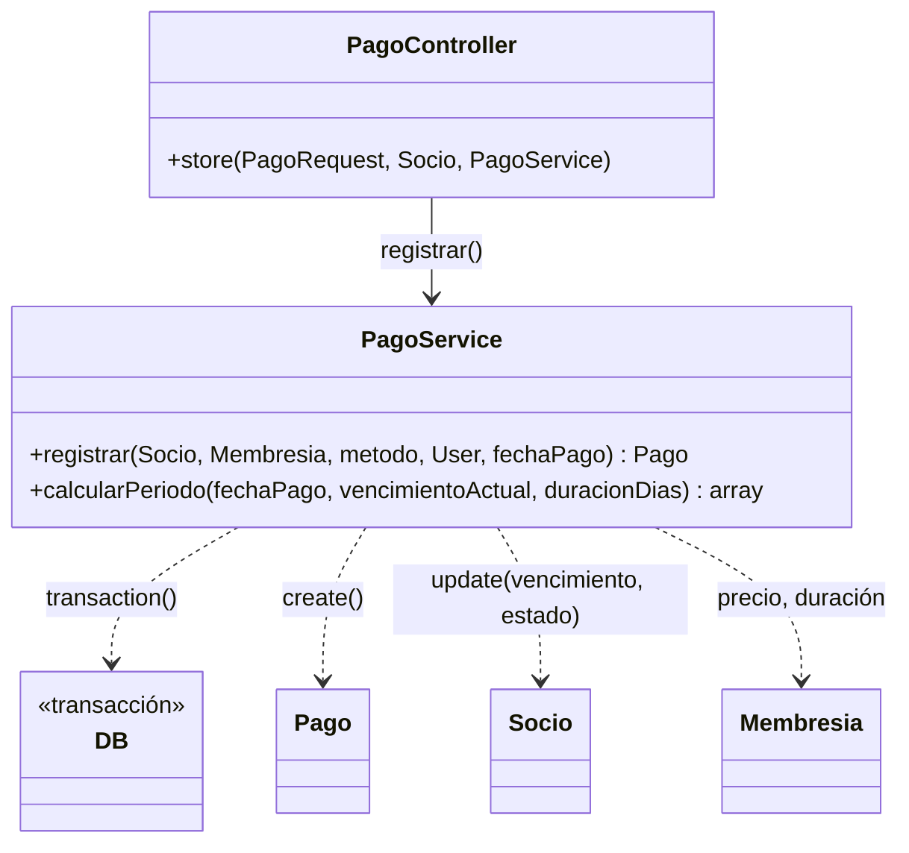
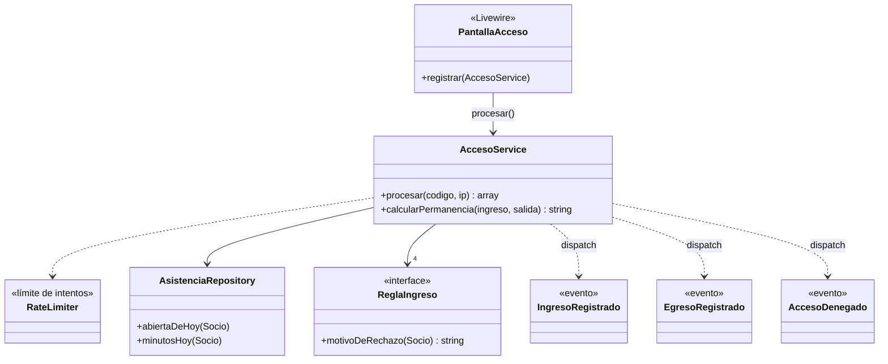

# Deuda técnica y patrones de diseño — Gym Control

Registro que pide Metodología de Sistemas II. Cada entrada sigue el formato **síntoma → deuda → patrón o
solución → consecuencia negativa asumida**, y responde las tres preguntas que el equipo se hace antes de aplicar
un patrón: 1) ¿el problema ya apareció 2 o 3 veces?, 2) ¿el cambio es probable o imaginario?, 3) ¿qué
consecuencia negativa introduce?

| # | Patrón | Historia | Estado |
|---|---|---|---|
| 1 | Repository | HU23 | Aplicado |
| 2 | Observer | HU21 | Aplicado |
| 3 | Strategy | HU22 | Aplicado |
| 4 | Facade | HU24 | Documentado (ya estaba en el código) |

## 1. Repository — consulta de "presentes hoy" (HU23)

**Síntoma.** La regla "un socio está presente si tiene una asistencia de hoy sin egreso" estaba escrita cinco
veces en cuatro clases, siempre como `abiertas()->whereDate('fecha', today())`:

| Dónde | Para qué |
|---|---|
| `AforoService::presentes()` | Contar personas para el aforo |
| `AccesoService::procesar()` | Decidir si el código registra un ingreso o un egreso |
| `DashboardController::index()` (dos veces) | Mostrar el total y la lista de presentes |
| `Portal\PortalController::inicio()` | Avisarle al socio que está dentro |

**Deuda.** Conocimiento duplicado (viola DRY y SRP): si la regla cambia, hay que encontrar y modificar las
cinco copias, y alcanza con olvidar una para que el aforo, el dashboard y la pantalla de acceso no coincidan.

**Las tres preguntas.**
1. ¿Se repite? Sí: cinco veces, en dos servicios y dos controladores.
2. ¿El cambio es probable? Sí. Hoy una asistencia de ayer sin egreso (el socio olvidó marcar la salida) deja
   de contar como presente a medianoche; es esperable que el gimnasio pida cerrarlas solas o usar una ventana
   de horas en lugar del día calendario.
3. ¿Qué consecuencia negativa introduce? Una clase y una indirección más (ver abajo).

**Solución.** `app/Repositories/AsistenciaRepository.php` concentra la regla en un método privado,
`presentes()`, y expone cuatro consultas con nombre del dominio: `cantidadPresentes()`, `presentesHoy()`,
`abiertaDeHoy(Socio)` y `estaDentro(Socio)`. Los servicios lo reciben por el constructor y los controladores
por parámetro (DIP: inyección de dependencias del contenedor de Laravel). Así queda la cadena
Controlador → Servicio → Repositorio → Modelo que pide Programación IV. El código viejo se borró, y
`AsistenciaRepositoryTest` verifica la regla (incluido el caso del socio que no marcó la salida ayer).

Con el mismo criterio se sumó `ultimosAccesosHoy()` (HU29): la usan dos pantallas, el dashboard y el panel de
recepción, así que la consulta se escribe una sola vez en el repositorio y no en cada controlador.

**Consecuencia negativa asumida.**
- Una capa más para leer: quien busca la consulta tiene que abrir el repositorio.
- El repositorio es una clase concreta, sin interfaz. Una interfaz solo se justificaría con una segunda
  implementación (por ejemplo, otra fuente de datos), y hoy no la hay: agregarla sería un cambio imaginario.
- Eloquent ya es en sí un repositorio (Active Record). Por eso no se crea un repositorio por cada tabla: solo
  para las consultas que se repiten.

**Alternativa descartada.** Un *scope* `presentesHoy()` en el modelo `Asistencia` también eliminaba la
duplicación, y con menos código. Se eligió el repositorio porque deja la regla fuera del modelo, porque se puede
inyectar y reemplazar en una prueba, y porque es el patrón que la cátedra pide demostrar.

## 2. Observer — eventos de la pantalla de acceso (HU21)

**Síntoma.** `AccesoService` decide el ingreso y el egreso, pero el sistema necesita enterarse de esas decisiones
en más de un lugar: hoy, para dejar constancia de cada acceso y de cada rechazo; en el Sprint 4, para avisar en
tiempo real al aforo del portal (HU25, Reverb). Hacerlo dentro del servicio lo obligaría a conocer a cada
interesado y a cambiar cada vez que aparece uno nuevo.

**Deuda.** Acoplamiento: el servicio de acceso tendría más de una razón para cambiar (viola SRP) y no se podría
sumar un interesado sin modificar código ya probado (viola OCP). Además, la pantalla de acceso deniega el ingreso
de forma automática y no quedaba registro del motivo, que es lo que se necesita para explicar después esa
decisión (art. 1757 CCyC).

**Las tres preguntas.**
1. ¿Se repite? Hay dos interesados en el mismo hecho: el registro de auditoría (ya implementado) y el aviso en
   tiempo real (HU25, ya implementado: listener `TransmitirAforo`).
2. ¿El cambio es probable? Sí: HU25 ya está en el Sprint 4, y otros interesados posibles son las estadísticas
   o una notificación a recepción.
3. ¿Qué consecuencia negativa introduce? El flujo deja de leerse de corrido (ver abajo).

**Solución.** El servicio es el **sujeto**: solo anuncia lo que pasó con tres eventos (`app/Events`):
`IngresoRegistrado`, `EgresoRegistrado` y `AccesoDenegado` (este último con los motivos). El **observador**
`app/Listeners/RegistrarAccesoEnLog.php` los escucha y escribe una línea en el log de la aplicación. Laravel lo
conecta solo, por descubrimiento de eventos: mira el tipo del parámetro de `handle()` (se puede ver con
`php artisan event:list`). Para sumar otro interesado se crea otro listener y `AccesoService` no se toca (OCP).
El log guarda solo el id del socio, nunca el nombre, el DNI ni el PIN (minimización de datos, Ley 25.326). En
Render el log va a `stderr` y se ve en el panel de logs del servicio.

**Pruebas.** `AccesoEventosTest` usa `Event::fake()` para comprobar que cada caso dispara su evento y que el
listener está registrado para los tres. También usa `Log::shouldReceive()` para comprobar que el rechazo guarda
los motivos y no el DNI. Detalle aprendido: `Event::fake()` sin argumentos también apaga los eventos de modelo
de Eloquent (`Socio::booted()` genera el PIN), por eso se le pasa la lista de eventos a simular.

**Consecuencia negativa asumida.**
- Indirección: leyendo `AccesoService` no se ve quién reacciona; hay que buscar los listeners o usar
  `php artisan event:list`.
- El listener corre en el mismo pedido (sincrónico). Si un día hiciera algo lento, conviene que implemente
  `ShouldQueue` para que vaya a la cola; hoy escribir una línea de log no lo justifica.
- Un log no es una tabla: sirve para auditar, pero no para hacer consultas. Si el gimnasio quisiera reportes de
  rechazos, haría falta persistirlos en la base.

## 3. Strategy — reglas de ingreso (HU22)

**Síntoma.** `AccesoService::ingreso()` tenía las cuatro condiciones de ingreso escritas como una cadena de `if`
(socio activo, cuota vigente, apto vigente y tope de horas diarias), y la del tope estaba repartida en dos
métodos privados más. Cada condición nueva obligaba a abrir y modificar el método que decide el acceso, que es
el más crítico y el más probado del sistema.

**Deuda.** Viola OCP (para extender hay que modificar código probado) y SRP (el servicio sabe *cómo* se evalúa
cada condición, además de *qué* hacer con el resultado). Además, la regla del tope solo se evaluaba si las
otras pasaban, así que el socio no se enteraba de todos sus problemas de una vez.

**Las tres preguntas.**
1. ¿Se repite? Sí: hay cuatro condiciones con la misma forma ("si no se cumple, este es el motivo").
2. ¿El cambio es probable? Sí: son reglas de negocio del gimnasio, y es esperable que aparezcan otras, como el
   horario de un plan, un feriado o un socio suspendido.
3. ¿Qué consecuencia negativa introduce? Cinco archivos chicos en lugar de un método (ver abajo).

**Solución.** La interfaz `app/Services/ReglasIngreso/ReglaIngreso.php` define la estrategia:
`motivoDeRechazo(Socio): ?string`. Hay cuatro implementaciones: `SocioActivo`, `CuotaVigente`,
`AptoFisicoVigente` y `TopeHorasDiarias`. `AccesoService` las recibe por el constructor (`ReglaIngreso
...$reglas`, DIP) y solo junta los motivos. La lista y su orden se configuran en un único lugar,
`AppServiceProvider::register()`, con un *binding contextual* del contenedor:
`when(AccesoService::class)->needs(ReglaIngreso::class)->give([...])`. Para sumar una regla se crea una
clase y se agrega a esa lista: `AccesoService` no se toca (OCP).

El cálculo de los minutos de hoy (`minutosHoy`) pasó a `AsistenciaRepository`, porque lo usan dos clases: la
regla del tope y el aviso del egreso.

**Cambio de comportamiento.** Ahora se evalúan todas las reglas y se muestran todos los motivos. Antes, el
motivo del tope solo aparecía si las otras tres condiciones se cumplían. Para recepción es mejor información, y
cumple con lo que pide Legislación: mostrar siempre el motivo de una decisión automatizada.

**Pruebas.** `ReglasIngresoTest` prueba cada regla por separado, el orden de los motivos y la demostración
de OCP: en la prueba se cambia la lista por una regla nueva ("cerrado por feriado") y el servicio la aplica sin
modificar su código. Las pruebas que ya existían en `AccesoTest` pasan sin cambios, lo que muestra que el
refactor no rompió el comportamiento (verificación).

**Consecuencia negativa asumida.**
- Más archivos: una regla de una línea ocupa una clase.
- La lista vive lejos del servicio, en `AppServiceProvider`: quien lee `AccesoService` tiene que saber dónde
  buscarla (se indica en el docblock del constructor).
- Se descartó dar a cada regla una prioridad o dejar que una regla corte la evaluación, porque hoy no hace
  falta: sería un cambio imaginario.

## 4. Facade — los servicios como fachada de cada módulo (HU24)

A diferencia de los tres patrones anteriores, este no se agregó: **ya estaba en el diseño** desde que se separó
la lógica de los controladores (Controlador → Servicio → Modelo). Esta entrada lo identifica y lo justifica, que
es lo que pide la cátedra: reconocer un patrón en el código propio y explicar qué problema resuelve.

**Qué es.** Una *fachada* ofrece una interfaz simple (uno o dos métodos) a un subsistema que por dentro tiene
varias piezas. El cliente llama a la fachada y no conoce esas piezas, así que puede cambiar el interior sin
tocar al cliente. No hay que confundirlo con las *Facades* de Laravel (`Log::`, `DB::`, `Event::`): esas son
accesos estáticos a servicios del contenedor. El nombre es parecido, pero el propósito es otro.

**Síntoma que evita.** Sin los servicios, el controlador de pagos tendría que abrir la transacción, calcular el
período, crear el pago y actualizar al socio. La pantalla de acceso tendría que limitar intentos, buscar al
socio por PIN o QR, evaluar las reglas, registrar la asistencia y disparar eventos. Esa lógica quedaría repetida
en cada punto de entrada (panel web, Livewire, una futura API) y mezclada con la presentación (viola SRP).

### PagoService: fachada del cobro

`PagoController::store()` solo llama a `registrar()`. Detrás de esa llamada hay una transacción, el cálculo del
período y la actualización de dos tablas.

### AccesoService: fachada del control de acceso

La pantalla de acceso (`PantallaAcceso`, Livewire) solo llama a `procesar(codigo, ip)` y recibe un resultado
listo para mostrar. Detrás de la fachada trabajan los otros tres patrones del proyecto: el **Repository** de
asistencias, las **Strategy** de ingreso y los eventos del **Observer**.

**Beneficios que se pueden mostrar en la defensa.**
- Los refactors de HU21, HU22 y HU23 cambiaron el interior de `AccesoService` y `PantallaAcceso` no se tocó:
  ese es el beneficio concreto de la fachada.
- Las reglas de negocio se prueban llamando a la fachada (`app(AccesoService::class)->procesar(...)` en
  `AccesoTest`), sin pasar por la interfaz.
- Si el sistema sumara otro punto de entrada (por ejemplo, un molinete que use la API), reutilizaría el mismo
  método.

**Consecuencia negativa asumida.**
- Una fachada puede crecer hasta convertirse en un "objeto dios" que sabe todo. Por eso cada servicio cubre un
  solo módulo, y cuando `AccesoService` empezó a acumular responsabilidades se las delegó al repositorio, a las
  reglas y a los eventos.
- `procesar()` devuelve un arreglo asociativo y no un objeto tipado: es simple para la vista, pero el
  compilador no controla sus claves. Un *DTO* (objeto de transferencia de datos) lo resolvería; queda como
  deuda menor, porque hoy lo consume una sola vista.

## Resumen para la defensa

| Patrón | Problema que resuelve en Gym Control | Dónde verlo | Prueba |
|---|---|---|---|
| Repository | La regla "presente hoy" estaba copiada cinco veces | `app/Repositories/AsistenciaRepository.php` | `AsistenciaRepositoryTest` |
| Observer | El acceso tenía que avisar a varios interesados sin conocerlos | `app/Events`, `app/Listeners` | `AccesoEventosTest` |
| Strategy | Sumar una condición de ingreso obligaba a modificar el servicio | `app/Services/ReglasIngreso` | `ReglasIngresoTest` |
| Facade | La lógica del cobro y del acceso no debía vivir en la presentación | `PagoService`, `AccesoService` | `PagoTest`, `AccesoTest` |
