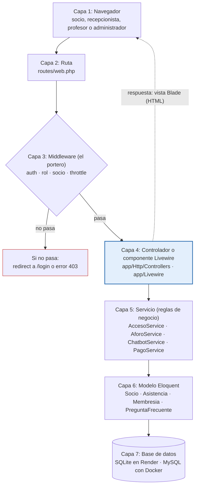
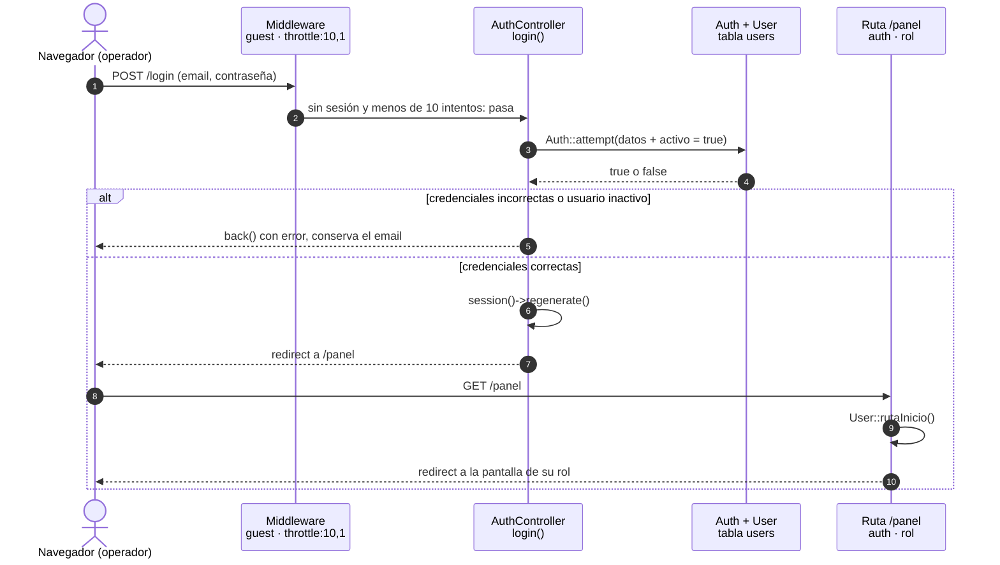
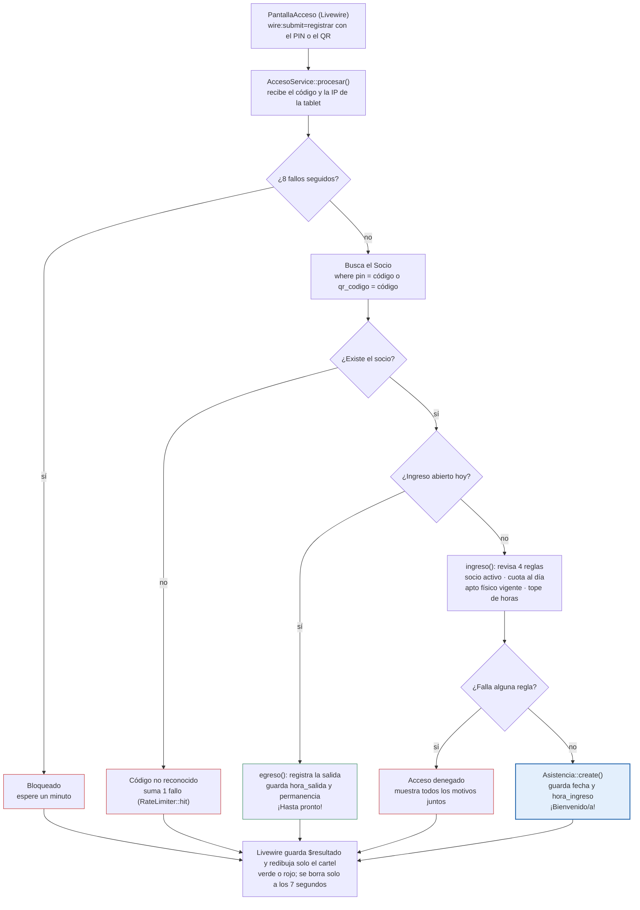
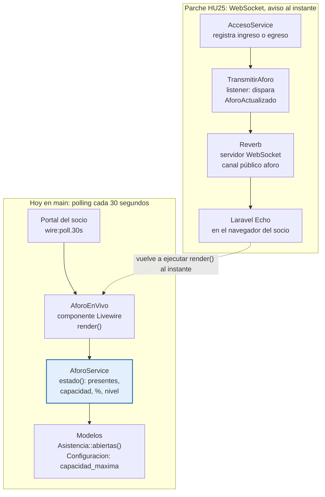
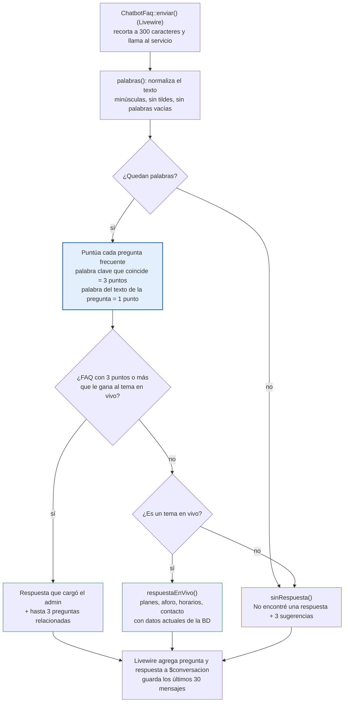

# GymControl: control de flujo del backend

Guía para entender (y exponer en clase) el camino que recorre cada pedido dentro del backend de GymControl: ruta → middleware → controlador o componente Livewire → servicio → modelo → base de datos.

Todo lo que sigue se tomó del código de la rama `main`. Lo que existe solo en los parches HU22 a HU25 (todavía no integrados a `main`) está marcado como **parche**.

## Índice

1. [Qué vamos a ver y cómo leerlo](#1-qué-vamos-a-ver-y-cómo-leerlo)
2. [La arquitectura por capas](#2-la-arquitectura-por-capas)
3. [Flujo 1: login y redirección por rol](#3-flujo-1-login-y-redirección-por-rol)
4. [Flujo 2: registro de ingreso del socio](#4-flujo-2-registro-de-ingreso-del-socio)
5. [Flujo 3: consulta de aforo en tiempo real](#5-flujo-3-consulta-de-aforo-en-tiempo-real)
6. [Flujo 4: chatbot de preguntas frecuentes](#6-flujo-4-chatbot-de-preguntas-frecuentes)
7. [Patrones de diseño dentro del flujo](#7-patrones-de-diseño-dentro-del-flujo)
8. [Guion para la clase](#8-guion-para-la-clase)

---

## 1. Qué vamos a ver y cómo leerlo

Cada vez que alguien usa GymControl, su navegador manda un **pedido** (request) al servidor y el servidor devuelve una **respuesta** (una página, un PDF o un trozo de pantalla). El **control de flujo** es el camino que recorre ese pedido adentro del backend: qué archivo lo recibe, quién decide si puede pasar, quién aplica las reglas del negocio y quién habla con la base de datos.

Conceptos que conviene tener claros antes de los diagramas:

- **Backend:** la parte del sistema que corre en el servidor (PHP con Laravel 12). El usuario no la ve; recibe pedidos y decide qué responder.
- **Ruta:** una regla que dice "si llega `GET /socio/aforo`, atendelo con tal clase". Están todas en `routes/web.php`.
- **Middleware:** un control de seguridad que se ejecuta antes de llegar al código principal. Es como el portero: si no tenés sesión o tu rol no corresponde, no pasás.
- **Controlador:** la clase que recibe el pedido ya autorizado, junta los datos y elige qué vista mostrar. No debería tener reglas de negocio complejas.
- **Componente Livewire:** un controlador "vivo": una clase PHP unida a una parte de la pantalla. Cuando el usuario toca un botón, Livewire manda un pedido chico y vuelve a dibujar solo esa parte, sin recargar la página.
- **Servicio:** la clase que contiene las reglas del negocio (por ejemplo, "solo entra quien tiene la cuota y el apto al día"). Están en `app/Services`.
- **Modelo (Eloquent):** la clase que representa una tabla de la base de datos (`Socio`, `Asistencia`, `Membresia`...). Sabe leer y guardar filas.

Cómo leer los diagramas: las flechas van en el orden en que se ejecuta el código. Cada sección cierra con **Observaciones** (qué notar del código) e **Indicaciones para exponer** (qué decir y qué mostrar).

> Los diagramas están escritos en [Mermaid](https://mermaid.js.org/): GitHub los dibuja automáticamente al abrir este archivo.

---

## 2. La arquitectura por capas

GymControl sigue el esquema clásico de Laravel: **cada capa tiene un solo trabajo y solo habla con la de abajo**. Así, si cambia una regla del negocio se toca un servicio, no diez pantallas.

El pedido baja de 1 a 7; la respuesta (la vista Blade ya armada con los datos) vuelve al navegador desde la capa 4. Si el middleware lo frena, el pedido nunca llega al controlador.

**Dónde se configura cada pieza en el código:**

| Pieza | Archivo | Qué hay que mostrar |
| --- | --- | --- |
| Rutas y grupos de roles | `routes/web.php` | Los grupos `guest`, `rol:administrador,recepcionista,profesor`, `rol:administrador,recepcionista` (con un subgrupo `rol:administrador`) y el prefijo `socio` |
| Registro de middleware | `bootstrap/app.php` | Los alias `rol` → `RolMiddleware` y `socio` → `SocioAutenticado` |
| Middleware de rol | `app/Http/Middleware/RolMiddleware.php` | Usuario inactivo → cierra sesión; rol no permitido → `abort(403)` |
| Middleware del portal | `app/Http/Middleware/SocioAutenticado.php` | Lee `socio_id` de la sesión y deja el `Socio` en `$request->attributes` |
| Servicios | `app/Services/*.php` | Laravel los crea solo y los pasa como parámetro (inyección de dependencias) |

**Observaciones**

- Hay **dos sistemas de login separados**: los operadores (admin, recepcionista, profesor) usan el login estándar de Laravel con email y contraseña; los socios usan DNI + PIN y una clave propia en la sesión (`socio_id`). Por eso hay dos middleware distintos.
- Los servicios no se crean con `new`: Laravel los **inyecta**. Por ejemplo `public function registrar(AccesoService $servicio)` en Livewire o `index(Request $request, AforoService $aforo)` en un controlador. Esto se llama *inyección de dependencias* y facilita las pruebas.
- Hoy los servicios usan los modelos directamente. El parche HU23 agrega una capa **Repositorio** entre el servicio y el modelo (ver sección 7).

**Indicaciones para exponer**

- Arrancá con una analogía: el gimnasio real. La ruta es la puerta, el middleware es el recepcionista que pide el carnet, el controlador es quien te atiende, el servicio es el reglamento y el modelo es el fichero de socios.
- Abrí `routes/web.php` en pantalla y señalá un grupo `Route::middleware([...])->group(...)`: es la forma más rápida de mostrar cómo se protegen muchas rutas a la vez.

---

## 3. Flujo 1: login y redirección por rol

Un **diagrama de secuencia** se lee de arriba abajo: cada columna es una pieza del sistema y cada flecha es un mensaje (una llamada o una respuesta). Las flechas punteadas son respuestas.

El operador manda email y contraseña; si son correctos y el usuario está activo, entra a `/panel`, que lo reenvía a la pantalla de su rol.

**Paso a paso en el código** (`app/Http/Controllers/AuthController.php`)

1. La ruta `POST /login` está en el grupo `guest` (solo para quien no tiene sesión) y tiene `throttle:10,1`: como máximo 10 intentos por minuto, contra ataques de fuerza bruta.
2. `login()` valida que llegue un `email` válido y una `password`.
3. `Auth::attempt($datos + ['activo' => true])` busca el usuario en la tabla `users`, compara la contraseña con su hash y **exige `activo = true`**. Un operador dado de baja no puede entrar aunque sepa la clave.
4. Si falla, `back()->withErrors(...)` vuelve al formulario con el mensaje de error y conserva el email escrito.
5. Si funciona, `session()->regenerate()` cambia el id de la sesión (evita el ataque de *fijación de sesión*) y redirige a `/panel`.
6. `/panel` está protegida con `auth` + `rol:administrador,recepcionista,profesor` y llama a `User::rutaInicio()`:

| Rol | Pantalla de inicio |
| --- | --- |
| administrador | `dashboard` (estadísticas) |
| profesor | `rutinas.index` (pedidos de rutina) |
| recepcionista | `socios.index` (listado de socios) |

**El login del socio es otro flujo** (`app/Http/Controllers/Portal/AuthSocioController.php`): pide DNI + PIN de 6 dígitos, cuenta los intentos fallidos **por DNI** con `RateLimiter` (5 intentos, bloqueo de 15 minutos), compara el PIN con `hash_equals()` y guarda solo `socio_id` en la sesión. Desde ahí, el middleware `socio` protege todas las rutas `/socio/...`.

**Observaciones**

- La autorización se revisa **en cada pedido**, no solo al entrar: `RolMiddleware` vuelve a mirar si el usuario sigue activo y si su rol está en la lista. Si el admin lo da de baja, la próxima pantalla lo saca.
- Diferencia clave: **autenticación** = ¿quién sos? (login). **Autorización** = ¿qué podés hacer? (middleware `rol`).
- `hash_equals()` compara en tiempo constante, para que no se pueda adivinar el PIN midiendo cuánto tarda la respuesta.

**Indicaciones para exponer**

- Mostrá en vivo: entrá como recepcionista y probá escribir `/dashboard` en la barra. Aparece el error 403: es el middleware trabajando.
- Remarcá la palabra *regenerate*: es una línea, pero es una buena práctica de seguridad que los profesores suelen preguntar.

---

## 4. Flujo 2: registro de ingreso del socio

Este es el flujo central del sistema. Tiene dos momentos: primero el recepcionista **da de alta** al socio, y después el socio **marca su ingreso** con su PIN o QR en la tablet de la entrada.

**Antes: el alta del socio** (`SocioController@store`, ruta `POST /socios`, solo admin y recepcionista). El controlador valida el formulario y hace `Socio::create(...)`. El modelo `Socio` tiene un evento `creating` que **genera solo** un PIN único de 6 dígitos y un `qr_codigo` (UUID). Después el sistema le avisa al recepcionista que cargue el apto físico y el primer pago, porque sin eso el socio no puede entrar.

**Después: el ingreso en la tablet.** La pantalla `/acceso` es un componente Livewire (`app/Livewire/PantallaAcceso.php`). Toda la decisión la toma `app/Services/AccesoService.php`:

El mismo código sirve para entrar y para salir: si el socio ya tiene un ingreso abierto hoy, el sistema registra su salida.

**Observaciones**

- **Controlador delgado, servicio grueso.** `PantallaAcceso::registrar()` tiene una sola línea de lógica: `$servicio->procesar($this->codigo, request()->ip())`. Todo lo demás es armar la respuesta para la vista. Las reglas viven en el servicio y por eso se pueden probar sin pantalla.
- **"Asistencia abierta"** = fila de `asistencias` de hoy con `hora_salida` vacía. Está definida una vez como *scope* en el modelo: `Asistencia::abiertas()`.
- **Seguridad:** 8 códigos erróneos desde la misma IP bloquean la tablet 1 minuto (`RateLimiter`), así nadie puede probar PINs al azar.
- **El egreso siempre se permite**, aunque la cuota haya vencido mientras entrenaba. Calcula la permanencia y avisa si superó el tope de horas de su plan.
- **Todos los motivos juntos:** si falla la cuota y el apto, el cartel muestra los dos. El socio sabe todo lo que tiene que regularizar de una vez.
- Si la cuota vence en 3 días o menos, el ingreso se permite pero aparece un aviso.

**Indicaciones para exponer**

- Este es el mejor flujo para la demo en vivo: mostrá un ingreso correcto (cartel verde), el mismo PIN otra vez (egreso con tiempo de permanencia) y un socio con la cuota vencida (cartel rojo con el motivo).
- Explicá que Livewire evita escribir JavaScript: el `wire:submit="registrar"` del formulario llama directo al método PHP del componente.
- Si te preguntan por qué no está todo en el controlador: porque el mismo servicio se puede reutilizar (por ejemplo desde una API o un lector de QR) y se prueba con tests unitarios.

---

## 5. Flujo 3: consulta de aforo en tiempo real

El **aforo** es cuánta gente hay ahora en el gimnasio. El sistema no necesita una tabla especial: lo calcula contando las asistencias de hoy que todavía no tienen hora de salida. Lo ve el socio en `/socio` y `/socio/aforo`, y también cualquier visitante en la página pública `/`.

Hay dos formas de que la pantalla se entere de que el número cambió. **Polling** = el navegador pregunta cada cierto tiempo ("¿cambió algo?"). **WebSocket** = una conexión que queda abierta y el servidor avisa en cuanto pasa algo.

La parte de arriba es lo que corre hoy en `main`; la de abajo la agrega el parche HU25 y reutiliza el mismo cálculo, solo cambia quién dispara la actualización.

**El cálculo** (`app/Services/AforoService.php`, método `estado()`):

- `presentes` = `Asistencia::abiertas()->whereDate('fecha', today())->count()`
- `capacidad` = el valor `capacidad_maxima` que carga el admin en Configuración (50 si no hay ninguno)
- `porcentaje` = presentes × 100 / capacidad, redondeado

| Nivel | Porcentaje | Lo que ve el socio |
| --- | --- | --- |
| libre | menos de 50 % | "Tranquilo. Buen momento para venir." (verde) |
| moderado | de 50 % a 79 % | "Moderado. Hay gente, pero se puede entrenar." (amarillo) |
| lleno | 80 % o más | "Muy concurrido. Puede haber espera en las máquinas." (rojo) |

**Horas pico** (`/socio/aforo`, `Portal/AforoController@index`): el controlador recibe el día de la semana por la URL (`?dia=1`), lo valida entre 0 y 6, y llama a `AforoService::horasPico()`. Ese método toma las asistencias de las **últimas 4 semanas** de ese día, cuenta cuántas personas estuvieron dentro en cada hora de 6 a 23 y saca el promedio. Si alguien no marcó la salida, se asume que se quedó 60 minutos.

**Observaciones**

- En `main`, el componente `AforoEnVivo` tiene **una sola línea**: `return view(..., $aforo->estado())`. La vista tiene `wire:poll.30s`, que le pide a Livewire volver a ejecutar `render()` cada 30 segundos.
- Con el parche HU25, cada ingreso o egreso dispara el evento `AforoActualizado` por el canal público `aforo`. El componente lo escucha con `#[On('echo:aforo,.aforo.actualizado')]` y se redibuja al instante. El `wire:poll.30s` queda como **respaldo** por si el WebSocket se cae.
- Si Reverb no responde, el listener captura el error (`try/catch` + `report($e)`): **el ingreso del socio nunca falla por culpa del aforo**.
- El mismo `AforoService` lo usa también el chatbot cuando le preguntan "¿hay mucha gente?". Un cálculo, tres pantallas.

**Indicaciones para exponer**

- Pregunta disparadora para la clase: "¿cómo sabe el celular del socio que alguien entró, si nadie recargó la página?". Dejá que respondan y después mostrá las dos partes del diagrama.
- Demo: abrí el portal en el celular y la tablet de acceso en la compu; marcá un ingreso y mostrá cómo cambia el número (al instante con Reverb, o dentro de los 30 segundos con polling).
- Aclará que Reverb está en un parche (HU25) y todavía no en `main`, si te lo preguntan.

---

## 6. Flujo 4: chatbot de preguntas frecuentes

El chatbot **no usa inteligencia artificial** (no tiene costo por uso): compara las palabras del mensaje con las preguntas que cargó el administrador y elige la que más coincide. Está en el portal (`/socio/preguntas`) y en la web pública (botón flotante).

Gana la respuesta con más puntos; si ninguna llega a 3, el chatbot no inventa: sugiere preguntas y deriva a recepción.

**Paso a paso en el código** (`app/Livewire/ChatbotFaq.php` y `app/Services/ChatbotService.php`)

1. El socio escribe y envía. `ChatbotFaq::enviar()` recorta el mensaje a 300 caracteres y llama a `$chatbot->responder($texto)`.
2. `palabras()` normaliza: pasa a minúsculas, quita tildes (`Str::ascii`), quita signos y descarta palabras vacías como "de", "la", "hola", "gimnasio". "¿A qué hora abren los sábados?" queda como `hora`, `abren`, `sabados`.
3. Cada `PreguntaFrecuente` activa recibe un puntaje. Para que "horario", "horarios" y "horas" coincidan, compara las primeras 4 letras (una raíz simple).
4. En paralelo busca un **tema en vivo** por lista de palabras: `planes`, `aforo`, `horarios`, `contacto`. Horarios y contacto solo se responden si el admin los cargó en Configuración.
5. Si la mejor FAQ tiene 3 puntos o más **y supera al tema en vivo**, responde con el texto del admin. Si no, y hay tema, arma la respuesta con datos actuales: membresías activas con precio, `AforoService::estado()`, o los datos de contacto.
6. El componente agrega los dos mensajes a `$conversacion` y se queda con los últimos 30.

**Observaciones**

- **Reutilización de servicios:** `ChatbotService` recibe `AforoService` por el constructor (`public function __construct(protected AforoService $aforo)`). Si le preguntan "¿hay mucha gente?", responde con el mismo cálculo de la sección 5.
- El límite de 30 mensajes no es estético: en Livewire el estado viaja en cada pedido, y una conversación sin límite haría cada pedido más pesado.
- Lo que dice el bot depende de los datos: el admin mejora las respuestas desde el ABM de preguntas (`/preguntas`, solo administrador) sin tocar código.
- Limitación a mencionar: al comparar palabras sueltas no entiende sinónimos ni frases mal escritas. Por eso el bot devuelve sugerencias en vez de inventar una respuesta.

**Indicaciones para exponer**

- Demo con tres preguntas: una que esté cargada en los datos de prueba ("¿tienen duchas?"), una de tema en vivo ("¿cuánto cuesta?") y una sin respuesta ("¿tienen pileta?"). Cada una muestra una rama del diagrama.
- Si te preguntan por qué no usaron IA: costo cero, respuestas controladas por el gimnasio y funcionamiento sin conexión a servicios externos.

---

## 7. Patrones de diseño dentro del flujo

Un **patrón de diseño** es una solución con nombre para un problema que se repite al programar. No es una librería: es una forma de ordenar las clases. En GymControl, `main` ya usa *Service Layer* e inyección de dependencias; los parches HU22 a HU25 suman patrones clásicos sobre los mismos flujos.

| Patrón | Problema que resuelve | Dónde entra en el flujo | Estado |
| --- | --- | --- | --- |
| Service Layer | Que las reglas no queden repartidas en controladores y vistas | Capa 5: `AccesoService`, `AforoService`, `ChatbotService`, `PagoService` | En `main` |
| Inyección de dependencias | Crear objetos a mano con `new` acopla las clases | Laravel pasa los servicios como parámetro o por constructor | En `main` |
| Repository | La regla "asistencia de hoy sin salida" estaba repetida 5 veces | `AsistenciaRepository` entre los servicios y el modelo `Asistencia` | Parche HU23 |
| Strategy | Agregar una regla de ingreso obligaba a modificar `AccesoService` | Interfaz `ReglaIngreso` con `SocioActivo`, `CuotaVigente`, `AptoFisicoVigente`, `TopeHorasDiarias`; el orden se configura en `AppServiceProvider` | Parche HU22 |
| Facade | El controlador no debería conocer los pasos internos de un pago o un acceso | `PagoService` y `AccesoService` ofrecen un solo método simple que esconde varios pasos | Parche HU24 (documentación con diagramas de clases) |
| Observer | Que el acceso no dependa de quién quiere enterarse de un ingreso | Eventos de ingreso y egreso; el listener `TransmitirAforo` avisa el aforo por Reverb | Parches (eventos de acceso + HU25) |

**Observaciones**

- Con **Strategy**, la caja "ingreso(): revisa 4 reglas" del diagrama de la sección 4 se convierte en una lista de objetos intercambiables. Sumar una quinta regla es agregar una clase nueva, sin tocar `AccesoService`. Eso es el principio **abierto/cerrado** (la O de SOLID).
- Con **Repository**, el servicio deja de saber cómo se consulta la base: pide `presentes()` y el repositorio resuelve el `where`. Si mañana cambia la consulta, se cambia en un solo lugar.
- Antes de exponer estos patrones como "implementados", confirmá si los parches ya se integraron a `main`.

**Indicaciones para exponer**

- Explicá cada patrón con la pregunta "¿qué pasaría si mañana cambia X?". Ejemplo: "si el gimnasio agrega una regla nueva de ingreso, ¿cuántos archivos toco?". Sin Strategy: el servicio. Con Strategy: solo una clase nueva.

---

## 8. Guion para la clase

Una exposición de unos 20 minutos alcanza para los cuatro flujos si cada uno se cuenta con su diagrama y una demo corta.

| Bloque | Tiempo | Qué mostrar | Idea que tiene que quedar |
| --- | --- | --- | --- |
| Introducción | 2 min | Sección 1 y la analogía del gimnasio real | Un pedido recorre capas, cada una con un solo trabajo |
| Arquitectura | 3 min | Diagrama de la sección 2 y `routes/web.php` | El middleware es el portero; el servicio tiene las reglas |
| Login por rol | 3 min | Diagrama de secuencia y el error 403 en vivo | Autenticación no es lo mismo que autorización |
| Ingreso del socio | 5 min | Diagrama de flujo + demo en `/acceso` (verde, egreso, rojo) | Controlador delgado, servicio grueso |
| Aforo | 3 min | Las dos partes del diagrama + el portal en el celular | Un mismo cálculo, tres pantallas; polling contra WebSocket |
| Chatbot | 2 min | Tres preguntas, una por rama | Sin IA: puntaje por palabras, nunca inventa |
| Patrones y cierre | 2 min | Tabla de la sección 7 | El código está preparado para cambiar |

**Antes de la clase**

- [ ] Tener la app corriendo con los datos de prueba (`SEED_DEMO=true` en el `.env` y después `php artisan migrate --seed`) y los usuarios `recepcion@gymcontrol.test` y `profesor@gymcontrol.test`.
- [ ] Preparar tres socios: uno al día, uno con la cuota vencida y uno sin apto físico, y anotar sus PIN.
- [ ] Abrir en pestañas: `routes/web.php`, `RolMiddleware.php`, `AccesoService.php`, `AforoService.php` y `ChatbotService.php`.
- [ ] Tener el portal del socio abierto en el celular para la demo de aforo.

**Preguntas que pueden hacerte**

- *¿Por qué dos logins distintos?* Porque socios y operadores son tablas y permisos distintos. El socio no tiene email ni contraseña: entra con DNI + PIN y su sesión guarda solo `socio_id`.
- *¿Qué pasa si dos socios marcan al mismo tiempo?* Cada marca es un pedido separado que crea su propia fila en `asistencias`; el aforo se recalcula contando filas, así que no se pisan.
- *¿Por qué Livewire y no una API con JavaScript?* Porque permite escribir la lógica de pantalla en PHP, el mismo lenguaje del backend, y Livewire se encarga de los pedidos y de redibujar.
- *¿Cómo se prueba?* Los servicios se pueden probar solos con PHPUnit, sin abrir el navegador. Ese es otro beneficio de sacar las reglas del controlador.
- *¿Qué mejorarías?* Integrar los parches de patrones y Reverb a `main`, y sumar sinónimos al chatbot.
