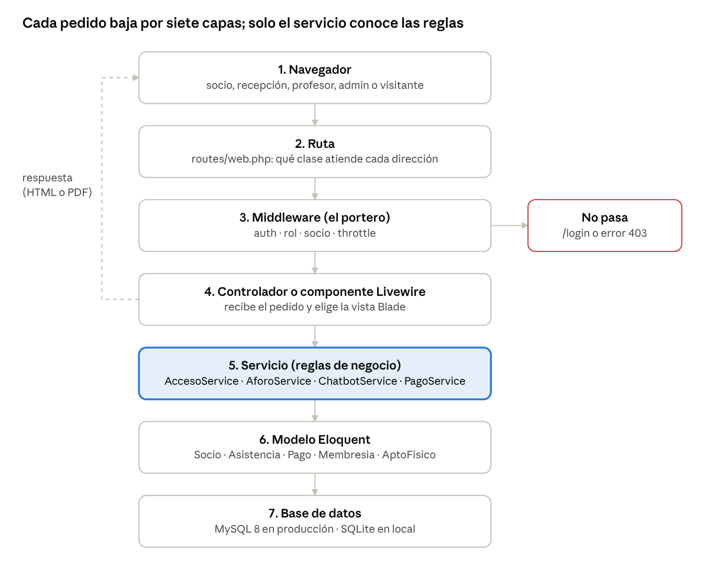
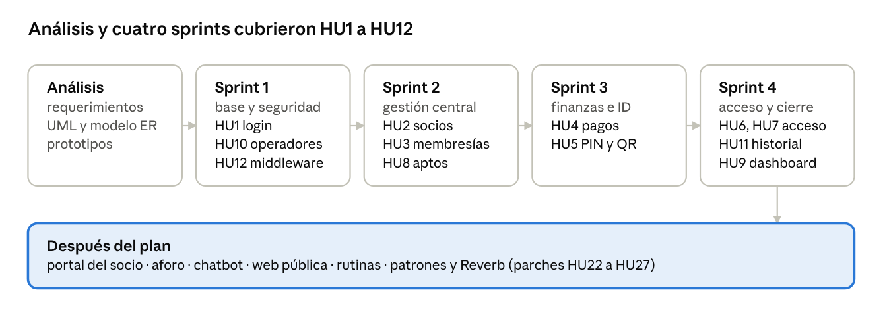

# Informe técnico: GymControl

Trabajo Final Integrador · Tecnicatura Universitaria en Programación (UTN) · 5 de noviembre de 2026 · Autor: Diego Fabián Cardozo

## Índice

1. [Resumen e introducción](#1-resumen-e-introducción)
2. [Marco conceptual](#2-marco-conceptual)
3. [Análisis del sistema](#3-análisis-del-sistema)
4. [Arquitectura y diseño](#4-arquitectura-y-diseño)
5. [Patrones de diseño](#5-patrones-de-diseño)
6. [Funcionalidades principales](#6-funcionalidades-principales)
7. [Metodología, calidad y estado actual](#7-metodología-calidad-y-estado-actual)
8. [Conclusiones, trabajo futuro y glosario](#8-conclusiones-trabajo-futuro-y-glosario)

## 1. Resumen e introducción

**Resumen.** GymControl es un sistema web que reemplaza el registro manual en cuadernos y planillas del Gimnasio Fénix (Formosa) por una base de datos central. El recepcionista da de alta al socio una sola vez; el sistema le asigna un PIN de 6 dígitos y un código QR, y con ellos el socio marca su ingreso y su egreso en una tablet. Antes de dejarlo pasar, el sistema verifica que la cuota y el apto físico estén vigentes. Sobre esa base se sumó un portal para el socio con aforo en vivo, chatbot de preguntas frecuentes, historial de pagos y pedido de rutinas.

El informe está escrito para que se entienda sin conocer el código: cada concepto técnico se explica la primera vez que aparece y los casos complejos llevan un ejemplo.

### 1.1 El problema

El gimnasio registraba a mano los socios, los pagos, las membresías y los certificados médicos. Con el crecimiento de la cantidad de clientes aparecieron tres problemas concretos:

- No se sabía con certeza quién tenía la cuota al día ni qué certificados médicos estaban vencidos.
- No se registraba cuánto tiempo permanecía cada socio, aunque los planes Básica y Media tienen un tope de horas diarias.
- Había registros duplicados y no existía información en tiempo real para decidir.

A esto se suma una necesidad del lado del socio: saber **antes de ir** cuánta gente hay en el gimnasio, porque la capacidad del local y de sus máquinas es limitada.

### 1.2 Objetivos

**Objetivo general.** Desarrollar e implementar un sistema web para la administración del gimnasio que gestione socios, pagos y accesos de forma segura y automatizada, y que brinde información en tiempo real para tomar decisiones.

**Objetivos específicos** (tomados del Plan de Trabajo aprobado):

1. Relevar las necesidades del Gimnasio Fénix y documentar los requerimientos funcionales y no funcionales.
2. Diseñar la arquitectura, los diagramas UML, el modelo de datos relacional y los prototipos de interfaz.
3. Implementar la autenticación de operadores con roles.
4. Desarrollar los módulos de socios, membresías, pagos y aptos físicos, con actualización automática de vencimientos.
5. Implementar el control de acceso por PIN y QR, con registro de ingreso, egreso y permanencia.
6. Construir el dashboard administrativo y los informes en PDF.
7. Probar el sistema, contenerizarlo con Docker y desplegarlo en Render con su documentación.

### 1.3 Alcance

| Incluido en el Plan aprobado (HU1 a HU12) | Agregado después del Plan |
| --- | --- |
| Login, roles y operadores | Portal del socio (DNI + PIN) |
| Socios con buscador, PIN y QR | Aforo en vivo y horas pico |
| Membresías, pagos y vencimientos | Chatbot de preguntas frecuentes |
| Aptos físicos | Página web pública del gimnasio |
| Pantalla de acceso por PIN y QR | Rutinas armadas por el profesor (rol nuevo) |
| Historial de asistencias en PDF y dashboard | Patrones Strategy, Repository y Facade; aforo por WebSocket (parches) |

Queda fuera del alcance el cobro en línea: el pago se registra en recepción y el sistema solo lo asienta.

## 2. Marco conceptual

Esta sección explica, en orden, los conceptos que el resto del informe usa. Cada uno se apoya en el anterior.

### 2.1 Aplicación web y modelo cliente-servidor

Una **aplicación web** es un programa que se usa desde el navegador, sin instalar nada. Funciona con el **modelo cliente-servidor**: el **cliente** (el navegador del recepcionista o el celular del socio) envía un **pedido** (*request*) y el **servidor** (la computadora donde corre GymControl) devuelve una **respuesta** (*response*), por ejemplo una página HTML o un PDF.

> **Ejemplo.** El socio abre `/socio/aforo` en su celular. El celular pide esa dirección al servidor; el servidor cuenta cuántas personas hay adentro y devuelve una página con el número. El celular solo dibuja lo que recibe.

El **backend** es la parte que corre en el servidor (reglas, datos, seguridad). El **frontend** es la parte que ve y toca el usuario (pantallas, botones, colores).

### 2.2 Patrón MVC

MVC (Modelo, Vista, Controlador) es una forma de separar el código en tres responsabilidades:

| Parte | Responsabilidad | En GymControl |
| --- | --- | --- |
| Modelo | Representa los datos y sabe leerlos y guardarlos | `Socio`, `Asistencia`, `Pago` |
| Vista | Muestra los datos al usuario | Plantillas Blade (`.blade.php`) |
| Controlador | Recibe el pedido, pide los datos al modelo y elige la vista | `SocioController`, `PagoController` |

La ventaja es que un cambio en el diseño de una pantalla no obliga a tocar las reglas, y viceversa.

### 2.3 Laravel y su ecosistema

Un **framework** es un conjunto de herramientas y convenciones que resuelve lo que todas las aplicaciones necesitan (rutas, sesiones, base de datos), para que el equipo se concentre en lo propio del negocio. GymControl usa:

- **Laravel 12 sobre PHP 8.3:** el framework del backend.
- **Eloquent (ORM):** un ORM traduce objetos a filas de tablas. En vez de escribir SQL a mano, se escribe `Socio::where('dni', $dni)->first()` y Eloquent arma la consulta.
- **Blade:** el motor de plantillas que genera el HTML.
- **Livewire 3 y Alpine.js:** permiten pantallas que se actualizan sin recargar la página, escribiendo la lógica en PHP en vez de JavaScript.
- **Tailwind CSS:** estilos visuales y diseño *responsive* (que se adapta a celular, tablet y PC).
- **DomPDF y Simple QrCode:** generan los informes PDF y los códigos QR.

### 2.4 Base de datos relacional

Una **base de datos relacional** guarda la información en **tablas** (filas y columnas) que se relacionan entre sí mediante **claves**. La **clave primaria** (`id`) identifica cada fila; la **clave foránea** es una columna que apunta al `id` de otra tabla.

> **Ejemplo.** La tabla `asistencias` tiene la columna `socio_id`. Si vale 7, esa asistencia pertenece al socio cuya fila en `socios` tiene `id = 7`. Así no se repite el nombre del socio en cada asistencia.

El sistema usa MySQL 8 en producción y SQLite para pruebas locales. Las **migraciones** de Laravel son archivos PHP que crean las tablas; permiten recrear la base idéntica en cualquier computadora.

### 2.5 Autenticación, autorización y middleware

- **Autenticación:** comprobar *quién sos* (login con email y contraseña, o DNI y PIN).
- **Autorización:** decidir *qué podés hacer* (un recepcionista no ve los ingresos económicos).
- **Middleware:** un filtro que se ejecuta antes de llegar al código principal. Funciona como el portero del gimnasio: si no tenés sesión o tu rol no corresponde, no pasás.
- **Hash:** transformación irreversible de una contraseña. Se guarda el hash, nunca la contraseña; al iniciar sesión se compara el hash de lo escrito con el guardado.

### 2.6 Patrón de diseño

Un **patrón de diseño** es una solución con nombre para un problema que se repite al programar. No es una librería que se instala: es una forma de organizar las clases. La sección 5 explica los que usa GymControl.

### 2.7 Polling y WebSocket

Para que una pantalla muestre datos que cambian (cuánta gente hay), hay dos estrategias:

- **Polling:** el navegador pregunta cada cierto tiempo "¿cambió algo?". Es simple, pero hay demora y pedidos inútiles.
- **WebSocket:** una conexión que queda abierta y el servidor avisa apenas algo cambia. Es inmediato, pero requiere un servidor extra (en este proyecto, Laravel Reverb).

### 2.8 Contenedores y despliegue

**Docker** empaqueta la aplicación con todo lo que necesita (PHP, extensiones, configuración) en un **contenedor**, que funciona igual en cualquier máquina. **Desplegar** es publicar la aplicación en un servidor accesible desde internet; GymControl se despliega en **Render**.

## 3. Análisis del sistema

### 3.1 Actores y roles

Un **actor** es cualquier persona (o sistema) que interactúa con la aplicación. El Plan aprobado definía dos operadores; hoy el sistema tiene cinco actores:

| Actor | Cómo entra | Qué puede hacer |
| --- | --- | --- |
| Administrador | Email y contraseña | Todo: operadores, membresías, bajas, dashboard económico, configuración, preguntas del chatbot |
| Recepcionista | Email y contraseña | Operación diaria: socios, aptos, pagos, pantalla de acceso, historiales |
| Profesor | Email y contraseña | Solo el módulo de rutinas: ve pedidos y arma rutinas |
| Socio | DNI y PIN en `/socio` | Consulta su cuota, asistencias, pagos, apto, aforo, chatbot y su rutina |
| Visitante | Sin login, en `/` | Ve la web pública, planes, horarios, aforo y chatbot |

### 3.2 Requerimientos funcionales

Un **requerimiento funcional (RF)** describe *qué debe hacer* el sistema. Los nueve del Plan, resumidos:

| Código | Requerimiento | Ejemplo de uso |
| --- | --- | --- |
| RF01 | Usuarios y sesión | El recepcionista inicia sesión a las 7:00 |
| RF02 | Gestión de socios, PIN y QR | Alta de un socio nuevo; el sistema genera su PIN 482913 |
| RF03 | Membresías | El admin sube el precio del plan Media |
| RF04 | Pagos y vencimientos | Se registra un pago y la cuota pasa a vencer en 30 días |
| RF05 | Aptos físicos | Se carga el certificado en PDF con su vencimiento |
| RF06 | Control de acceso | El socio ingresa con su PIN en la tablet |
| RF07 | Historial de asistencias | Informe PDF de las asistencias de un mes |
| RF08 | Dashboard e informes | El admin ve cuántos socios están vencidos |
| RF09 | Operadores | El admin da de baja a un recepcionista |

### 3.3 Requerimientos no funcionales

Un **requerimiento no funcional (RNF)** describe *cómo* debe comportarse el sistema (calidad, seguridad, rendimiento), no una función concreta.

| Código | Requerimiento | Cómo se cumple |
| --- | --- | --- |
| RNF01 | Seguridad | Contraseñas con bcrypt, middleware de rol, límite de intentos de PIN, datos personales según Ley 25.326 |
| RNF02 | Rendimiento (menos de 2 s) | Índices en DNI, PIN, QR y fechas |
| RNF03 | Disponibilidad | Docker y Render; respaldos de la base |
| RNF04 | Usabilidad | Cartel verde o rojo grande en la tablet, con el motivo |
| RNF05 | Mantenibilidad | Capas separadas y pruebas PHPUnit |
| RNF06 | Compatibilidad | Diseño responsive con Tailwind |

### 3.4 Historias de usuario

Una **historia de usuario (HU)** es un requerimiento escrito desde el punto de vista de quien lo usa, con la forma *"Como [rol], quiero [acción] para [beneficio]"*. Es la unidad de trabajo de Scrum.

> **Ejemplo (HU6).** *Como socio, quiero ingresar con mi PIN para no esperar en el mostrador.* Criterios de aceptación: si la cuota y el apto están vigentes, se registra el ingreso; si no, se muestra el motivo; el mismo PIN otra vez registra el egreso y la permanencia.

El backlog del Plan contiene HU1 a HU12. Después se agregaron, entre otras, HU22 (Strategy), HU23 (Repository), HU24 (Facade), HU25 (aforo con Reverb), HU27 (pedidos de rectificación de datos) y HU29 (panel de recepción).

## 4. Arquitectura y diseño

### 4.1 Arquitectura por capas

Una **arquitectura por capas** divide el sistema en niveles donde cada uno tiene un solo trabajo y solo habla con el de abajo. GymControl extiende el MVC de Laravel con una capa de **servicios**, donde viven las reglas del negocio.



El pedido baja de la capa 1 a la 7; la respuesta vuelve al navegador desde el controlador. Si el middleware lo frena, el pedido nunca llega al controlador.

> **Ejemplo (analogía).** En el gimnasio real, la ruta es la puerta, el middleware es el recepcionista que pide el carnet, el controlador es quien te atiende, el servicio es el reglamento y el modelo es el fichero de socios.

Dos ideas sostienen esta arquitectura:

- **Controlador delgado, servicio grueso.** La pantalla de acceso tiene una sola línea de lógica: `$servicio->procesar($codigo, $ip)`. Todas las reglas están en `AccesoService`, así se pueden probar sin abrir el navegador y reutilizar desde otra pantalla.
- **Inyección de dependencias.** Las clases no crean sus servicios con `new`: Laravel se los entrega como parámetro. Por ejemplo, `ChatbotService` recibe `AforoService` en su constructor. Esto permite reemplazar una pieza en las pruebas sin modificar la clase que la usa.

El detalle de cada flujo (login, ingreso, aforo y chatbot) con diagramas de secuencia está en [`FLUJO-BACKEND.md`](FLUJO-BACKEND.md).

### 4.2 Dos sistemas de login

Los operadores (admin, recepcionista, profesor) usan el login estándar de Laravel con email y contraseña, limitado a 10 intentos por minuto. Al entrar, `session()->regenerate()` cambia el identificador de sesión para evitar el ataque de *fijación de sesión*.

Los socios usan DNI y PIN en `/socio`. Se permiten 5 intentos fallidos por DNI y luego hay un bloqueo de 15 minutos. El PIN se compara con `hash_equals()`, que tarda siempre lo mismo, para que nadie pueda adivinar dígitos midiendo el tiempo de respuesta.

### 4.3 Modelo de datos

El núcleo son seis tablas del Plan aprobado; después se sumaron configuración, preguntas frecuentes y rutinas.

| Tabla | Guarda | Columnas clave | Se relaciona con |
| --- | --- | --- | --- |
| `users` | Operadores | email, password (hash), rol, activo | Registra socios, pagos y aptos |
| `membresias` | Planes Básica, Media, Premium | precio, duracion_dias, horas_diarias_max (vacío = pase libre) | Un plan tiene muchos socios |
| `socios` | Clientes del gimnasio | dni, pin, qr_codigo (los tres únicos), estado, fecha_vencimiento | Pertenece a una membresía |
| `pagos` | Cobros | importe, fecha_pago, periodo_desde, periodo_hasta, metodo_pago | Un socio tiene muchos pagos |
| `aptos_fisicos` | Certificados médicos | fecha_emision, fecha_vencimiento, archivo | Un socio tiene muchos aptos |
| `asistencias` | Ingresos y egresos | fecha, hora_ingreso, hora_salida, tiempo_permanencia | Un socio tiene muchas asistencias |
| `configuraciones` | Ajustes del admin | capacidad_maxima, horarios, contacto | Ninguna |
| `preguntas_frecuentes` | Base del chatbot | pregunta, respuesta, palabras clave | Ninguna |
| `rutinas`, `rutina_ejercicios`, `solicitudes_rutina` | Pedidos y rutinas | objetivo, nivel, días, series, repeticiones | Socio y profesor |

Tres decisiones de diseño merecen explicación:

1. **Baja lógica.** Un socio dado de baja no se borra: se marca con `deleted_at` (*soft delete*). Así se conserva su historial de pagos y asistencias.
2. **El importe se copia en el pago.** `pagos.importe` guarda el precio *al momento del cobro*. Si el admin sube el precio del plan, los pagos viejos no cambian.
3. **Índices.** Un índice es como el índice de un libro: permite encontrar una fila sin recorrer toda la tabla. Hay índices en `dni`, `pin`, `qr_codigo`, `fecha_vencimiento` y en el par (`socio_id`, `fecha`), las columnas que más se buscan (RNF02).

> **Ejemplo: cómo se calcula el vencimiento (`PagoService`).** Un socio con plan Media (30 días) tiene la cuota vigente hasta el 10/11. Paga el 05/11, antes de que venza. El nuevo período no empieza el 05/11 sino el **11/11** (el día siguiente al vencimiento) y termina el **10/12**. Así el socio no pierde los días que ya había pagado. Si hubiera pagado con la cuota ya vencida, el período empezaría el mismo día del pago. Todo ocurre dentro de una **transacción**: si falla cualquier paso, no se guarda nada a medias.

## 5. Patrones de diseño

Los patrones se presentan con la misma estructura: el problema concreto que había en GymControl, la solución y un ejemplo. Una aclaración importante: en la rama `main` del repositorio hoy están **Service Layer** e **inyección de dependencias**. Strategy, Repository, Facade y la parte de Observer con Reverb están escritos como parches (HU22 a HU25) que todavía no se integraron a `main`.

| Patrón | Problema que resuelve | Estado |
| --- | --- | --- |
| Service Layer | Reglas repartidas en controladores y vistas | En `main` |
| Inyección de dependencias | Clases atadas entre sí por crear objetos con `new` | En `main` |
| Strategy | Agregar una regla de ingreso obligaba a modificar `AccesoService` | Parche HU22 |
| Repository | La consulta "asistencia de hoy sin salida" estaba repetida en 5 lugares | Parche HU23 |
| Facade | El controlador conocía los pasos internos de un pago | Parche HU24 (documentación) |
| Observer | El acceso tenía que conocer a todos los que quieren enterarse de un ingreso | Parche HU25 |

### 5.1 Strategy

**Qué es.** Strategy define una familia de algoritmos intercambiables detrás de una misma interfaz. Una **interfaz** es un contrato: dice qué métodos debe tener una clase, pero no cómo los implementa.

**Problema.** El ingreso valida cuatro condiciones (socio activo, cuota al día, apto vigente, tope de horas) con cuatro `if` dentro de `AccesoService`. Si el gimnasio pide una quinta regla, por ejemplo "no puede entrar fuera del horario de su plan", hay que abrir y modificar el servicio, con el riesgo de romper lo que ya funciona.

**Solución.** Cada regla es una clase que cumple la interfaz `ReglaIngreso`:

```php
interface ReglaIngreso
{
    // Devuelve el motivo del rechazo, o null si la regla se cumple.
    public function motivoDeRechazo(Socio $socio): ?string;
}

class CuotaVigente implements ReglaIngreso
{
    public function motivoDeRechazo(Socio $socio): ?string
    {
        return $socio->cuotaAlDia() ? null : 'Cuota vencida: regularice su pago en recepción.';
    }
}
```

La lista de reglas, en orden, se configura en un solo lugar (`AppServiceProvider`), y `AccesoService` solo recorre la lista y junta los motivos.

> **Ejemplo.** Para agregar la regla de horario se crea la clase `DentroDelHorario implements ReglaIngreso` y se suma a la lista. `AccesoService` no se toca. Esto es el **principio abierto/cerrado** (la O de SOLID): el código está *abierto* a extenderse y *cerrado* a modificarse.

### 5.2 Repository

**Qué es.** Un repositorio es una clase intermedia entre el servicio y el modelo, que esconde *cómo* se consultan los datos.

**Problema.** La condición "asistencia de hoy con `hora_salida` vacía" (es decir, la persona sigue adentro) aparecía en el acceso, el aforo, el dashboard y el portal. Si cambiaba la definición, había que corregir cinco lugares.

**Solución.** `AsistenciaRepository` ofrece métodos con nombre de negocio, como `presentes()`. El servicio pide "los presentes" sin saber qué `where` hay detrás.

> **Ejemplo.** Si mañana se decide que un ingreso sin salida de más de 6 horas ya no cuenta como presente (alguien olvidó marcar la salida), se cambia una línea en el repositorio y el aforo, el dashboard y el portal quedan correctos a la vez.

### 5.3 Facade

**Qué es.** Una fachada ofrece un único método simple que esconde varios pasos internos.

**Ejemplo en el sistema.** `PagoService::registrar()` es la fachada del cobro. El controlador hace una sola llamada, y adentro ocurren cuatro pasos: calcular el período, crear el pago, actualizar el plan y el vencimiento del socio y reactivarlo, todo dentro de una transacción. Lo mismo hace `AccesoService::procesar()` con el ingreso y el egreso. El controlador no necesita saber nada de esos pasos.

No confundir con las *Facades* de Laravel (`Auth::`, `DB::`), que son otra cosa: accesos estáticos a servicios del framework.

### 5.4 Observer

**Qué es.** Un objeto (el *sujeto*) avisa que ocurrió algo, y los interesados (*observadores*) reaccionan, sin que el sujeto los conozca.

**En GymControl.** Cuando se registra un ingreso o un egreso, se dispara el evento `AforoActualizado`. El *listener* `TransmitirAforo` lo escucha y envía el nuevo número por WebSocket. `AccesoService` no sabe que existe el aforo en vivo: si mañana se quiere también enviar un aviso al profesor, se agrega otro listener.

## 6. Funcionalidades principales

### 6.1 Control de acceso por PIN y QR

Es el flujo central. Al dar de alta un socio, el modelo `Socio` genera solo un **PIN** único de 6 dígitos y un **código QR** que contiene un UUID (un identificador de 36 caracteres prácticamente imposible de repetir). En la tablet de la entrada, `AccesoService::procesar()` sigue estos pasos:

1. Si hubo 8 códigos erróneos seguidos desde esa tablet, la bloquea 1 minuto (evita probar PINs al azar).
2. Busca al socio por PIN o por QR. Si no existe, responde "Código no reconocido" y suma un fallo.
3. Si el socio tiene un ingreso **abierto** hoy (sin hora de salida), registra el **egreso**: guarda la hora y calcula la permanencia. El egreso se permite siempre, aunque la cuota haya vencido mientras entrenaba.
4. Si no, intenta el **ingreso** y revisa las cuatro reglas. Si falla alguna, deniega y muestra **todos** los motivos juntos.
5. Si pasa, crea la asistencia y responde "¡Bienvenido/a!". Si la cuota vence en 3 días o menos, agrega un aviso.

> **Ejemplo completo.** Laura tiene plan Básica (tope de 2 h por día). Marca su PIN a las 18:00: cartel verde. Marca otra vez a las 19:40: egreso con permanencia de 1 h 40 min. Vuelve a las 21:00 y marca: ingreso permitido (lleva 100 de 120 minutos). Sale a las 21:30: el egreso se registra igual, pero avisa "Superó el tope diario de 2 h". Si al día siguiente su cuota estuviera vencida y su apto también, el cartel rojo mostraría los dos motivos a la vez, para que regularice todo en una sola visita.

### 6.2 Portal del socio

En `/socio`, el socio entra con DNI y PIN y consulta: estado de su membresía y cuota, historial de asistencias con filtro por fechas, pagos con comprobante PDF, constancias de apto médico, aforo, chatbot y su rutina. Es una interfaz de **solo consulta**: el socio no puede modificar datos sensibles.

### 6.3 Aforo en vivo y horas pico

El **aforo** es cuánta gente hay ahora en el local. No requiere una tabla nueva: `AforoService` cuenta las asistencias de hoy sin hora de salida y las compara con la `capacidad_maxima` que carga el administrador (50 si no hay ninguna).

| Nivel | Porcentaje de ocupación | Mensaje al socio |
| --- | --- | --- |
| Libre (verde) | Menos de 50 % | "Tranquilo. Buen momento para venir." |
| Moderado (amarillo) | De 50 % a 79 % | "Hay gente, pero se puede entrenar." |
| Lleno (rojo) | 80 % o más | "Puede haber espera en las máquinas." |

> **Ejemplo de cálculo.** Capacidad 60 y 33 personas adentro: 33 × 100 / 60 = 55 %, nivel moderado (amarillo). Si entran 15 más, 48 / 60 = 80 %: pasa a rojo.

**Horas pico.** Para que el socio planifique, `/socio/aforo` muestra un gráfico por hora (de 6 a 23) para el día de la semana elegido, con el promedio de las últimas 4 semanas. Si alguien no marcó la salida, se asume que estuvo 60 minutos.

**Actualización.** En `main` la pantalla usa *polling*: `wire:poll.30s` vuelve a calcular el aforo cada 30 segundos. El parche HU25 agrega **Laravel Reverb**, un servidor WebSocket: cada ingreso o egreso emite el evento `AforoActualizado` por el canal público `aforo`, y **Laravel Echo** (en el navegador) redibuja el número al instante. El polling queda como respaldo, y si Reverb falla el error se registra sin afectar el ingreso del socio.

### 6.4 Chatbot de preguntas frecuentes

El chatbot **no usa inteligencia artificial**: no tiene costo por uso, no depende de servicios externos y solo responde lo que el gimnasio cargó. Funciona por puntaje de palabras clave:

1. **Normaliza** el mensaje: minúsculas, sin tildes, sin signos y sin palabras vacías ("de", "la", "hola").
2. **Compara raíces**: usa las primeras 4 letras, para que "horario", "horarios" y "horas" coincidan.
3. **Puntúa** cada pregunta frecuente: 3 puntos por palabra clave que coincide, 1 por palabra del texto de la pregunta.
4. Si la mejor llega a 3 puntos, responde con el texto del administrador y sugiere hasta 3 preguntas relacionadas.
5. Si no, revisa si es un **tema en vivo** (planes y precios, aforo, horarios, contacto) y responde con datos actuales de la base.
6. Si nada coincide, no inventa: dice que no encontró respuesta y ofrece sugerencias.

> **Ejemplo.** "¿A qué hora abren los sábados?" queda como `hora`, `abren`, `sabados`. La FAQ de horarios tiene la palabra clave "horario" (raíz `hora`): suma 3 puntos y gana. En cambio, "¿hay mucha gente?" no coincide con ninguna FAQ pero sí con el tema en vivo *aforo*: el bot responde con el mismo cálculo de la sección 6.3, por ejemplo "Ahora hay 33 personas (55 %)". "¿Tienen pileta?" no suma puntos y el bot deriva a recepción.

La conversación guarda solo los últimos 30 mensajes, porque en Livewire el estado viaja en cada pedido y una conversación infinita lo volvería cada vez más pesado.

### 6.5 Rutinas con profesor

El socio pide una rutina desde el portal indicando objetivo, nivel, días por semana y comentarios. El profesor ve los pedidos, arma los ejercicios por día (series, repeticiones, descanso y notas) y el socio la ve agrupada por día. Una rutina nueva reemplaza a la anterior. El rol `profesor` solo accede a este módulo.

### 6.6 Página web pública, dashboard e informes

- **Web pública (`/`):** presentación, servicios, planes con precios tomados de las membresías activas, horarios, contacto, aforo y chatbot. El administrador edita los textos sin tocar código.
- **Dashboard:** socios al día y vencidos, presentes ahora, ingresos del día y del mes, asistencias de los últimos 7 días.
- **Informes PDF:** ficha del socio con su credencial QR, historial de asistencias y de pagos.

## 7. Metodología, calidad y estado actual

### 7.1 Metodología Scrum

**Scrum** es una metodología ágil: en lugar de planificar todo al inicio y entregar al final, el trabajo se divide en **sprints** (ciclos cortos, aquí de dos semanas) y al cierre de cada uno hay algo funcionando para mostrar. Las historias pendientes forman el **product backlog**. La Product Owner fue la tutora de la empresa (Viviana Machuca); el seguimiento se hizo en un tablero Kanban de Jira (To Do, In Progress, In Review, Done).



Una historia se consideró **terminada** cuando estaba implementada, probada, integrada en la rama principal de GitHub y verificada contra sus criterios de aceptación.

### 7.2 Estimación con PERT

El Plan estimó 450 horas de trabajo (150 por integrante). Cada actividad tuvo tres estimaciones en días: optimista (a), más probable (m) y pesimista (b). La duración esperada se calcula con:

```math
t_e = \frac{a + 4m + b}{6}
```

> **Ejemplo.** Si una tarea puede tardar 4 días en el mejor caso, 6 lo más probable y 11 en el peor, t = (4 + 24 + 11) / 6 = 6,5 días. El valor más probable pesa cuatro veces más que los extremos.

La **ruta crítica** es la cadena de actividades sin holgura: si una se atrasa, se atrasa todo el proyecto. En GymControl es A → B → C → D → F → H/I → K → L, con una duración esperada de 65 días y, con 95 % de confianza, no más de 68.

### 7.3 Control de versiones e integración continua

Cada funcionalidad se desarrolló en una **rama** propia de Git y se integró a `main` mediante un **pull request** (pedido de revisión antes de mezclar el código). El historial de `main` muestra esa secuencia: portal del socio, aforo, chatbot, web pública, historiales y rutinas. La **integración continua (CI)** de GitHub ejecuta las pruebas automáticamente con PHP 8.3 y 8.4 en cada cambio.

### 7.4 Pruebas automatizadas

Una **prueba automatizada** es código que ejecuta el sistema y verifica el resultado esperado, sin intervención humana. Las **pruebas de integración** (*Feature*) recorren un flujo completo, desde la ruta hasta la base de datos.

En `main` hay 9 archivos de pruebas de integración con unos 59 casos: acceso, aforo, chatbot, pagos, portal, historiales, roles, rutinas y web pública. Cubren, entre otros: PIN y QR únicos, ingreso y egreso con permanencia, cuota vencida, apto vencido, egreso siempre permitido, tope de horas, pase libre, límite de intentos y control de roles.

> **Ejemplo de prueba.** Se crea un socio con la cuota vencida, se envía su PIN a la pantalla de acceso y se verifica que el resultado sea "denegado", que el motivo diga "Cuota vencida" y que **no** se haya creado ninguna asistencia.

### 7.5 Despliegue

El sistema corre en local con `docker compose up` (incluye MySQL y datos de demostración) y en producción en Render. El archivo `render.yaml` describe el servicio; [`DEPLOY.md`](../DEPLOY.md) documenta los pasos.

### 7.6 Estado actual

| Componente | Estado al 05/11/2026 |
| --- | --- |
| HU1 a HU12 del Plan | Completas en `main` |
| Portal, aforo con polling, chatbot, web pública, rutinas | Completos en `main` |
| Strategy, Repository, Facade (HU22 a HU24) | Parches listos, sin integrar a `main` |
| Aforo por WebSocket con Reverb (HU25) | Parche listo, sin integrar |
| Pedidos de rectificación de datos (HU27) | Parche listo, sin integrar |
| Licencia | MIT |

La nota de versión v1.0.0 describe el sistema **con** los parches integrados (132 pruebas, API con Sanctum, respaldo en Aiven). Antes de presentar el informe conviene integrar los parches o ajustar esa nota para que coincida con `main`.

## 8. Conclusiones, trabajo futuro y glosario

### 8.1 Conclusiones

GymControl cumplió el alcance del Plan aprobado (HU1 a HU12) y lo superó: además de digitalizar socios, pagos, aptos y asistencias, le da al socio una forma de decidir **antes de ir** si le conviene entrenar, mirando el aforo en vivo y las horas pico, y le responde las dudas frecuentes sin pasar por recepción.

Desde lo técnico, las lecciones principales son tres:

1. **Separar responsabilidades paga.** Como las reglas viven en servicios, el mismo cálculo de aforo sirve al portal, a la web pública y al chatbot sin duplicarse.
2. **La seguridad está en los detalles.** Límite de intentos, regeneración de sesión, comparación en tiempo constante y hash de contraseñas son líneas cortas que evitan ataques reales.
3. **Una solución simple puede ser la correcta.** El chatbot por palabras clave no tiene costo, no inventa respuestas y el gimnasio lo mejora sin programar.

### 8.2 Limitaciones y trabajo futuro

- Integrar a `main` los parches HU22 a HU27 (Strategy, Repository, Facade, Reverb y pedidos de datos) y actualizar la cantidad de pruebas.
- Sumar sinónimos al chatbot, porque hoy no entiende palabras distintas con el mismo significado ("pileta" y "piscina").
- El aforo depende de que los socios marquen la salida; se podría cerrar automáticamente los ingresos sin egreso al final del día.
- Pago en línea de la cuota desde el portal.
- Notificaciones al socio cuando la cuota o el apto estén por vencer.

### 8.3 Glosario

| Término | Significado breve |
| --- | --- |
| Aforo | Cantidad de personas dentro del local en un momento dado |
| Backend / Frontend | Parte del sistema en el servidor / parte que ve el usuario |
| CI | Integración continua: pruebas automáticas en cada cambio de código |
| Eloquent (ORM) | Herramienta de Laravel que traduce objetos PHP a filas de la base |
| Hash | Transformación irreversible usada para guardar contraseñas |
| Inyección de dependencias | El framework entrega a una clase los objetos que necesita |
| Livewire | Componentes PHP que redibujan parte de la página sin recargarla |
| Middleware | Filtro que se ejecuta antes del controlador (el "portero") |
| Migración | Archivo que crea o modifica tablas de forma reproducible |
| Polling | El navegador pregunta cada cierto tiempo si hay cambios |
| Pull request | Pedido de revisión antes de integrar una rama a `main` |
| Soft delete | Baja lógica: la fila se marca como borrada pero se conserva |
| Sprint | Ciclo de trabajo de Scrum, aquí de dos semanas |
| Transacción | Grupo de operaciones que se guardan todas juntas o ninguna |
| WebSocket | Conexión abierta por la que el servidor avisa cambios al instante |

### Fuentes

- Código de este repositorio, rama `main` (`README.md`, servicios, migraciones y pruebas).
- Plan de Trabajo aprobado del TIF, documento [`FLUJO-BACKEND.md`](FLUJO-BACKEND.md), parches HU22 a HU27 y nota de versión v1.0.0.
