# Manual de usuario de Gym Control

**Sistema:** Gym Control, gestión y control de asistencia del Gimnasio Fénix (Formosa).
**Versión del sistema:** 1.0 · **Equipo:** Grupo 13, Cardozo Diego Fabián, Heretichi Adriana y López Gabriela
Elvira.
**Corresponde a:** actividad L del Plan de Trabajo (despliegue y documentación) y anexo 11 del informe final.

## 1. Introducción

Este manual explica cómo usar Gym Control, paso a paso, para cada tipo de usuario. Está pensado para personas
sin conocimientos técnicos: el personal de recepción, la administración, el profesor y los socios del gimnasio.
La instalación y el despliegue se describen en el manual técnico (`README.md` y `DEPLOY.md`).

Las capturas se tomaron con los datos de demostración del sistema, por lo que nombres, DNI y PIN son ficticios.

### 1.1 Requisitos

- Una computadora, tablet o celular con un navegador actualizado (Chrome, Firefox, Edge o Safari).
- Conexión a internet.
- Para la pantalla de acceso con código QR: un lector de códigos USB o la cámara del dispositivo.

### 1.2 Tipos de usuario

| Usuario | Cómo entra | Qué puede hacer |
|---|---|---|
| Recepcionista | Correo y contraseña en `/login` | Atiende el mostrador: socios, aptos físicos, pagos, pantalla de acceso e historiales |
| Administrador | Correo y contraseña en `/login` | Todo lo del recepcionista, más el dashboard económico, bajas, membresías, operadores, preguntas frecuentes, configuración y pedidos sobre datos personales |
| Profesor | Correo y contraseña en `/login` | Ve los pedidos de rutina de los socios y los arma |
| Terminal de acceso | Correo y contraseña en `/login`, una sola vez en la tablet o PC de la entrada | Solo abre la pantalla de acceso donde los socios marcan su PIN o QR; no ve socios, pagos ni importes |
| Socio | DNI y PIN en `/socio/login` | Consulta su cuenta, el aforo, el chatbot, pide una rutina y ejerce sus derechos sobre sus datos |
| Visitante | No necesita cuenta | Ve la web pública del gimnasio |

Cada usuario ve en el menú solo las opciones que le corresponden. Si alguien escribe a mano la dirección de una
pantalla que no le corresponde, el sistema responde con un error 403 (acceso prohibido).

## 2. Web pública

Al abrir la dirección del sistema aparece la web del gimnasio, con la presentación, los servicios, los planes con
su precio, los horarios, el contacto, el aforo en vivo y un chatbot. Los botones **Soy socio** y **Personal** llevan
al portal del socio y al sistema del personal.

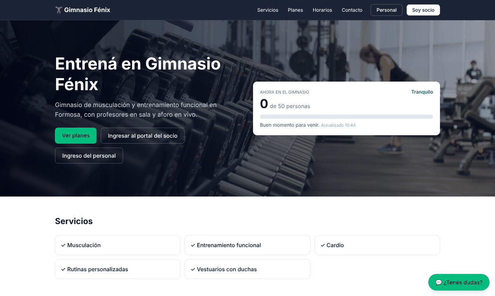

## 3. Ingreso del personal

1. Desde la web, presionar **Personal** o abrir `/login`.
2. Escribir el correo electrónico y la contraseña, y presionar **Ingresar**.
3. El sistema abre la pantalla de inicio del rol: **Recepción** para el recepcionista, **Dashboard** para el
   administrador y **Rutinas** para el profesor.

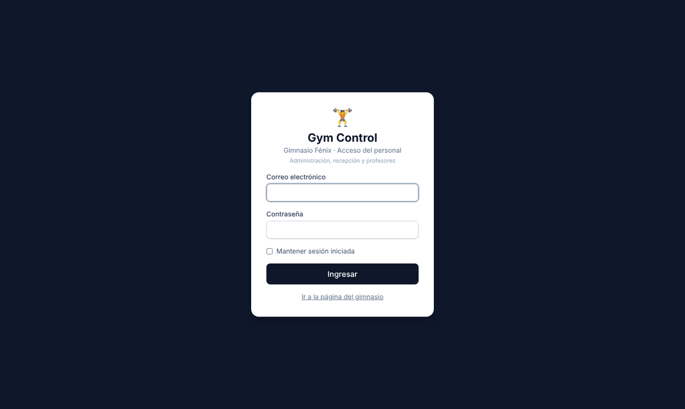

Para salir, presionar **Salir** arriba a la derecha. Por seguridad, después de varios intentos fallidos el
sistema bloquea el ingreso durante un minuto, y un operador desactivado no puede entrar.

## 4. Recepcionista

### 4.1 Panel de recepción

Es la primera pantalla del recepcionista. Reúne lo que se usa en el mostrador:

- **Buscador rápido:** escribir nombre, apellido, DNI o PIN y presionar **Buscar**. Se abre el listado de socios
  ya filtrado.
- **Socios en sala:** cuántas personas hay en el gimnasio y desde qué hora está cada una.
- **Últimos accesos de hoy:** los ingresos y egresos del día, del más reciente al más antiguo. Los socios que
  todavía no salieron muestran la etiqueta *en sala*.
- **Abrir pantalla de acceso:** lleva a la pantalla de ingreso y egreso.

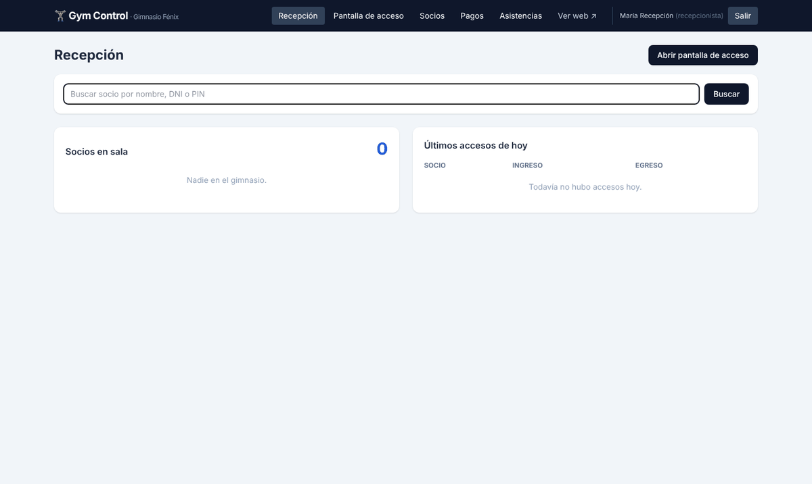

### 4.2 Pantalla de acceso (ingreso y egreso)

Es la pantalla que queda abierta en la tablet o PC de la entrada. Lo recomendable es iniciar sesión ahí con una
cuenta de rol **Terminal de acceso** (la crea el administrador en *Operadores*): esa cuenta va directo a esta
pantalla y no puede abrir ninguna otra, así que si alguien escribe otra dirección en el navegador de la tablet no ve
datos de socios ni importes. Para cerrar la terminal, el administrador la desactiva en *Operadores*. En una tablet
Android conviene además **fijar la pantalla** (*screen pinning*) para que no se pueda salir del navegador.

Un recepcionista o administrador también puede abrirla:

1. Abrir **Pantalla de acceso** desde el menú.
2. El socio marca su **PIN** de 6 dígitos con el **teclado numérico de la pantalla** (pensado para tablets táctiles;
   *Limpiar* borra todo y ⌫ el último número) o con el teclado físico, y presiona **Registrar**. También puede pasar
   su credencial por el lector de QR.
   También se puede usar **Escanear QR con la cámara**.
3. El sistema responde en pantalla:
   - **Verde, "¡Bienvenido/a!":** el ingreso quedó registrado con la hora. Si la cuota vence en los próximos 3
     días, se muestra un aviso.
   - **Verde, "¡Hasta pronto!":** si el socio ya estaba dentro, el mismo código registra el **egreso** y muestra
     el tiempo de permanencia. El egreso se permite siempre, aunque la cuota o el apto hayan vencido.
   - **Rojo, "Acceso denegado":** el ingreso no se registra y se muestran **todos** los motivos.

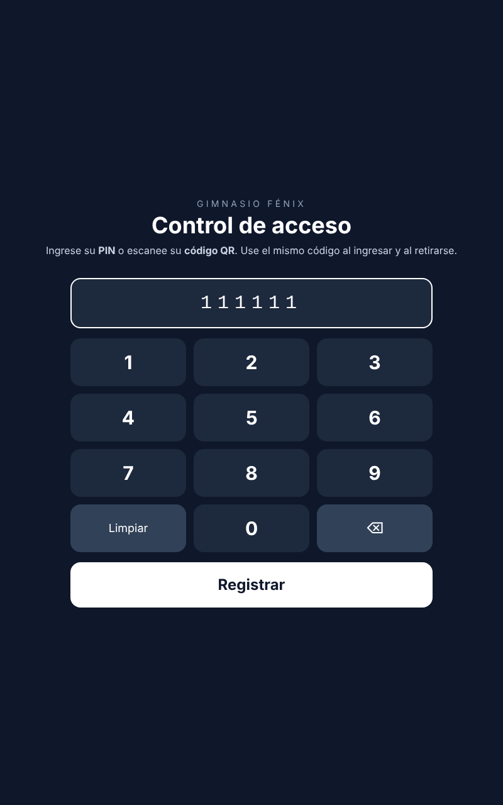

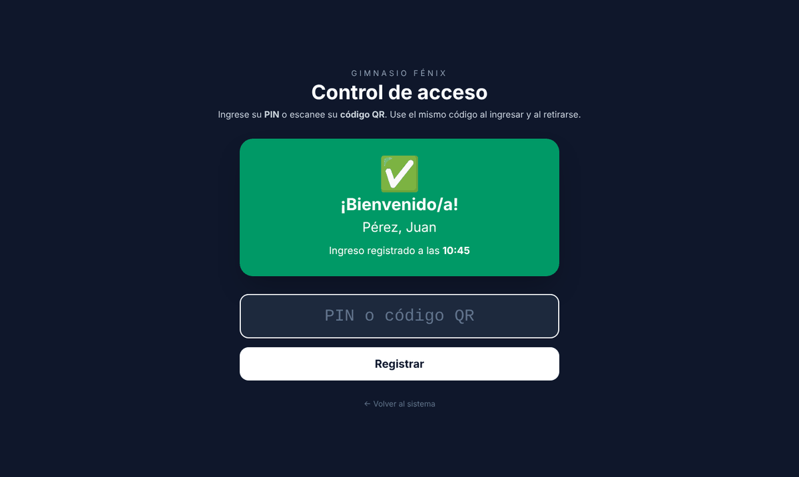

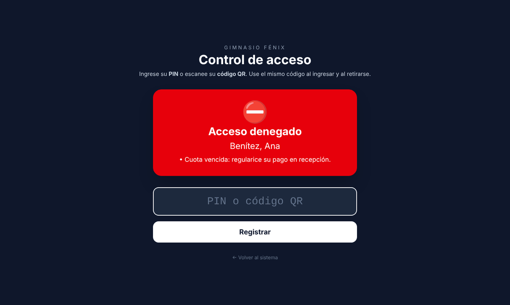

Para ingresar, el socio tiene que cumplir las tres condiciones a la vez: estar activo, tener la cuota al día y
tener el apto físico vigente. Además, no tiene que haber alcanzado el tope de horas diarias de su plan (el plan
Premium no tiene tope).

| Motivo que muestra la pantalla | Qué hacer en recepción |
|---|---|
| Cuota vencida: regularice su pago en recepción. | Registrar el pago (sección 4.5) |
| Apto físico vencido o no presentado. | Cargar un apto vigente en la ficha del socio (sección 4.4) |
| Socio dado de baja o inactivo. | Consultar al administrador, que puede reactivarlo |
| Alcanzó el tope de horas diarias de su membresía. | Informar al socio; puede cambiar de plan al pagar |
| Código no reconocido. Consulte en recepción. | Verificar el PIN en la ficha del socio o reimprimir la credencial |
| Demasiados intentos fallidos. Espere un minuto y vuelva a intentar. | Esperar un minuto; el bloqueo evita que se prueben PIN al azar |

Para volver al sistema, usar **Volver al sistema** al pie de la pantalla.

### 4.3 Socios

En **Socios** está el listado completo, con un buscador que filtra mientras se escribe (por nombre, apellido,
DNI o PIN) y un filtro por estado: todos, cuota al día y cuota vencida. El administrador ve además el filtro
*Dados de baja*.

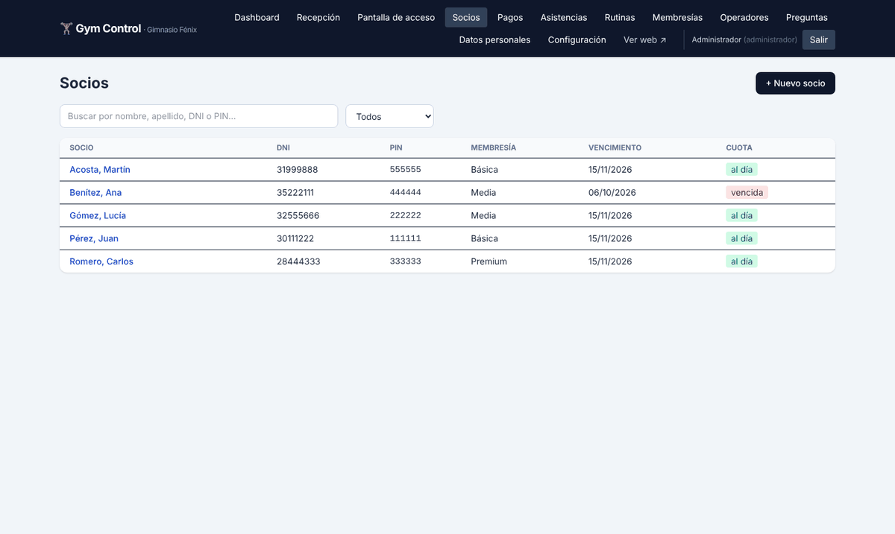

**Registrar un socio nuevo**

1. Presionar **+ Nuevo socio**.
2. Completar nombre, apellido, DNI (solo números, sin puntos), teléfono, correo y la membresía elegida.
3. Mostrarle al socio el **aviso de privacidad** y, si lo acepta, marcar la casilla de consentimiento. Sin ese
   consentimiento no se podrá cargar su apto físico, porque es un dato de salud (Ley 25.326).
4. Presionar **Guardar**. El sistema genera automáticamente un **PIN de 6 dígitos** y un **código QR**, únicos
   para ese socio.

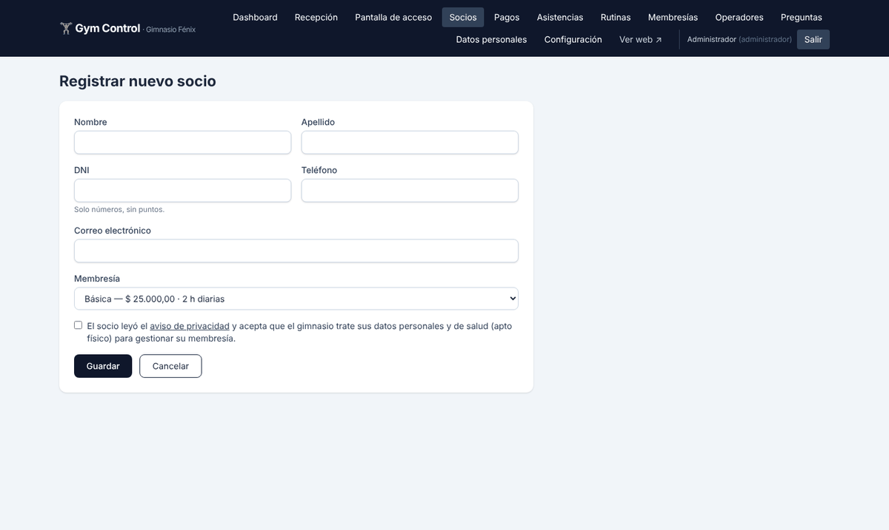

El DNI no puede repetirse: si ya existe un socio con ese DNI, el formulario lo avisa.

### 4.4 Ficha del socio y apto físico

Al hacer clic en un socio se abre su ficha, con su membresía, el estado de la cuota y del apto, su PIN, los
últimos pagos y las últimas asistencias. Desde los botones de arriba se puede:

- **Editar** los datos personales (y registrar el consentimiento de socios cargados antes de este requisito).
- **Credencial PIN/QR:** muestra la credencial lista para imprimir y entregar al socio.
- **Registrar pago** (sección 4.5).
- **Ficha PDF:** descarga la ficha personal para imprimir.

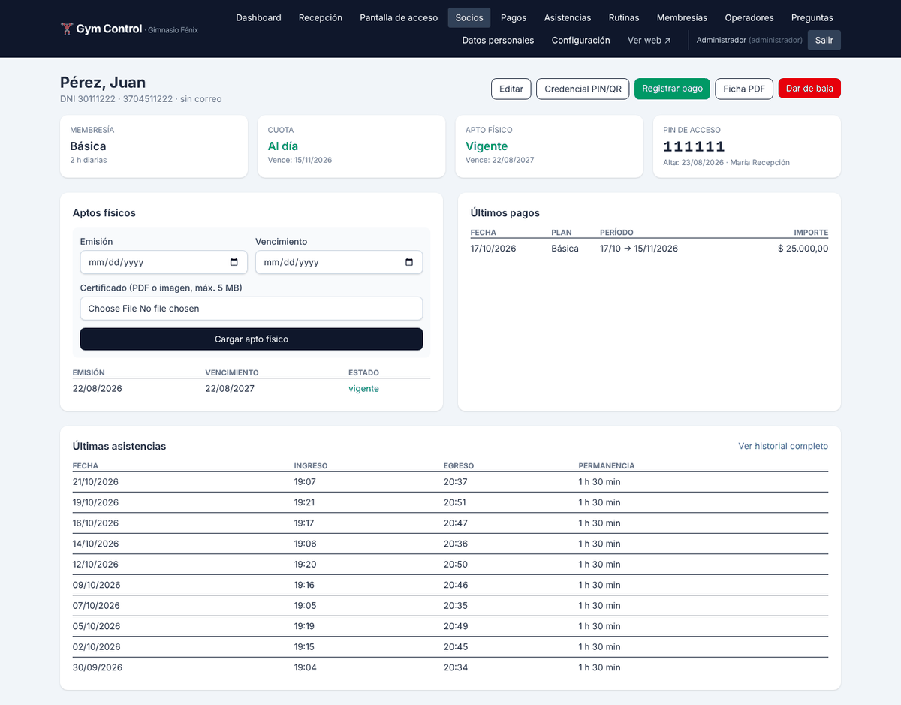

**Cargar el apto físico:** en el recuadro *Aptos físicos*, completar la fecha de emisión y la de vencimiento,
adjuntar el certificado (PDF o imagen de hasta 5 MB) y presionar **Cargar apto físico**. El archivo se guarda en
un espacio privado: solo el personal con sesión iniciada y el propio socio pueden descargarlo. Todos los días a
las 00:05 el sistema marca como *vencido* cada apto cuya fecha ya pasó.

### 4.5 Pagos

1. Desde la ficha del socio, presionar **Registrar pago**.
2. Elegir la membresía a abonar y el método de pago (efectivo, transferencia, débito o crédito).
3. Presionar **Confirmar pago**.

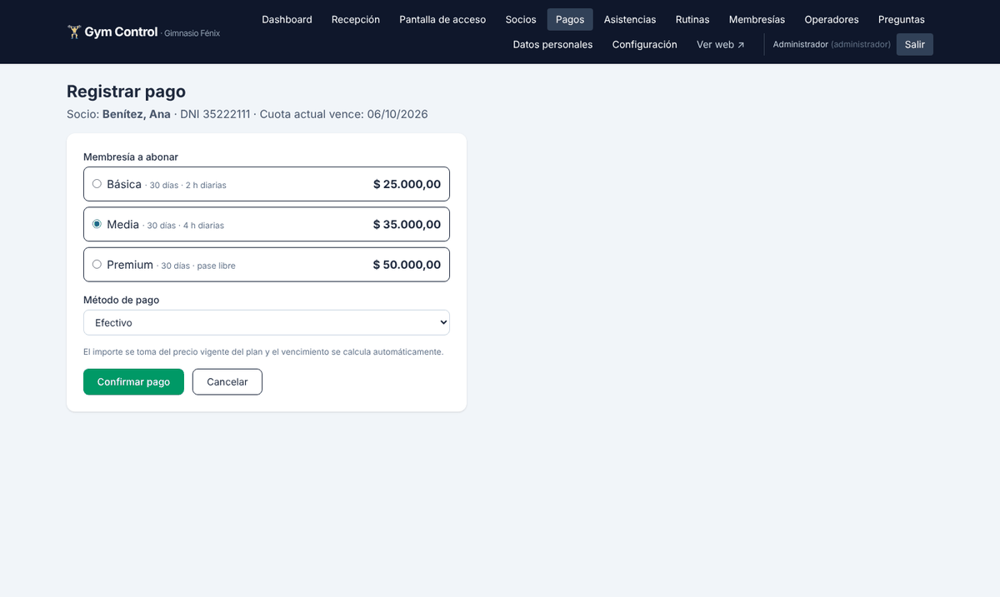

El importe se toma del precio vigente del plan y el vencimiento se calcula solo:

- Si la cuota **todavía no venció**, el nuevo período empieza el día siguiente al vencimiento actual, así el socio
  no pierde días por pagar antes.
- Si la cuota **ya venció**, el nuevo período empieza el día del pago.

En **Pagos** está el historial de cobros, con filtros por socio y por fechas, y el botón para descargarlo en PDF.

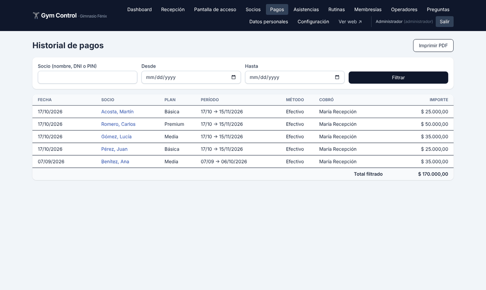

### 4.6 Historial de asistencias

En **Asistencias** se consultan los ingresos y egresos con filtros por socio y por rango de fechas. Cada fila
muestra la fecha, la hora de ingreso, la de egreso y la permanencia; quien sigue dentro figura *en sala*. El
resultado se puede descargar en PDF.

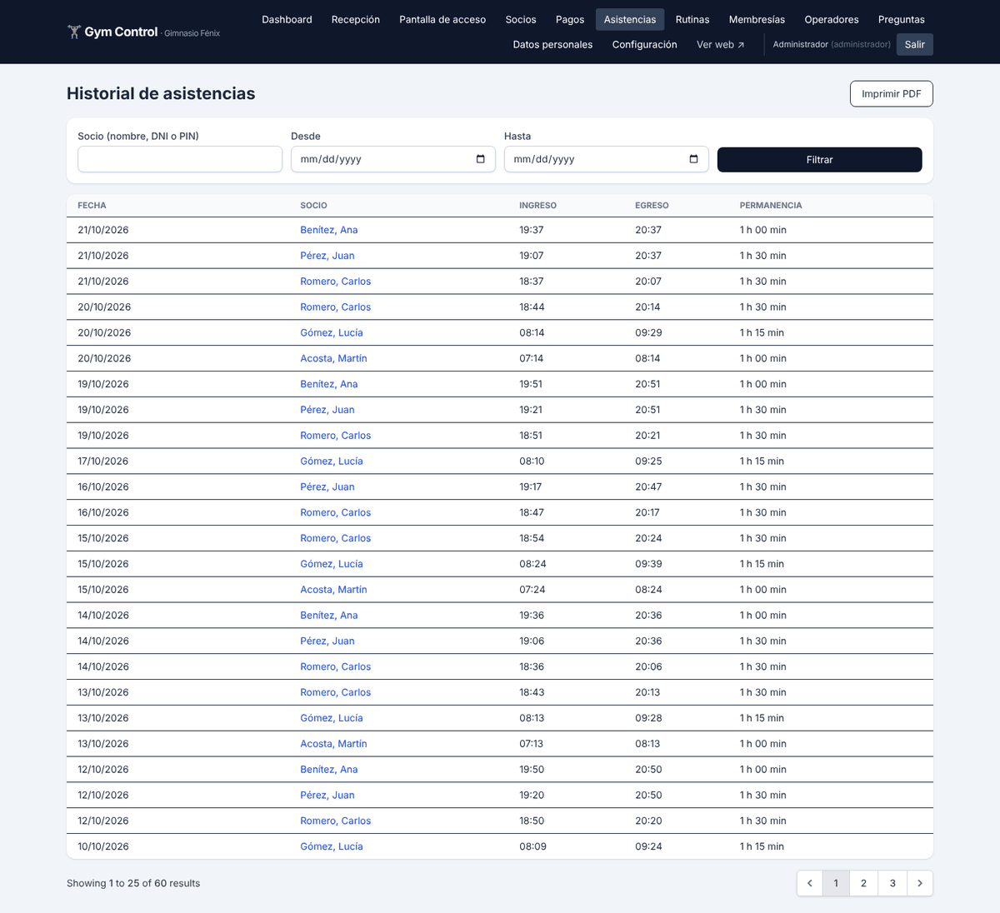

## 5. Administrador

El administrador tiene todo lo del recepcionista y además las siguientes opciones.

### 5.1 Dashboard

Muestra los indicadores del gimnasio: socios con cuota al día y vencida, presentes ahora, asistencias de hoy,
ingresos del día y del mes, cuotas que vencen en los próximos 7 días y socios activos sin apto vigente. Abajo
están el gráfico de asistencias de los últimos 7 días, los ingresos del mes por membresía, los socios presentes,
los últimos accesos y los últimos pagos.

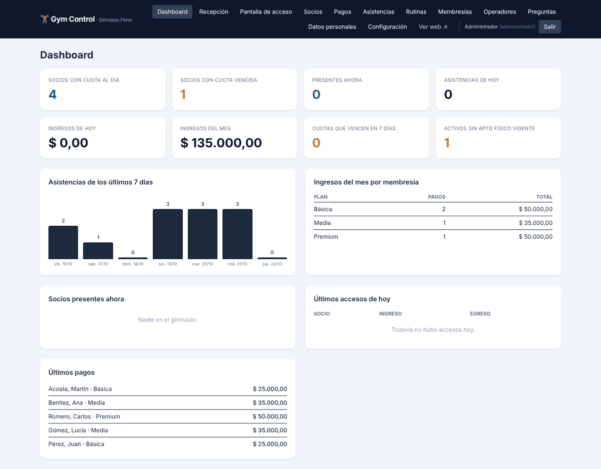

### 5.2 Baja y reactivación de socios

En la ficha del socio, **Dar de baja** realiza una **baja lógica**: el socio deja de poder ingresar, pero su
historial de pagos y asistencias se conserva. Para recuperarlo, buscarlo con el filtro *Dados de baja* y usar
**Reactivar**.

### 5.3 Membresías

En **Membresías** se crean y modifican los planes: nombre, precio, duración de la cuota en días, tope de horas
diarias (vacío significa pase libre) y estado. Un plan *inactivo* no se ofrece en altas ni pagos nuevos, pero los
socios que ya lo tienen lo conservan. Cambiar un precio no modifica los pagos anteriores, porque cada pago guarda
el importe que se cobró.

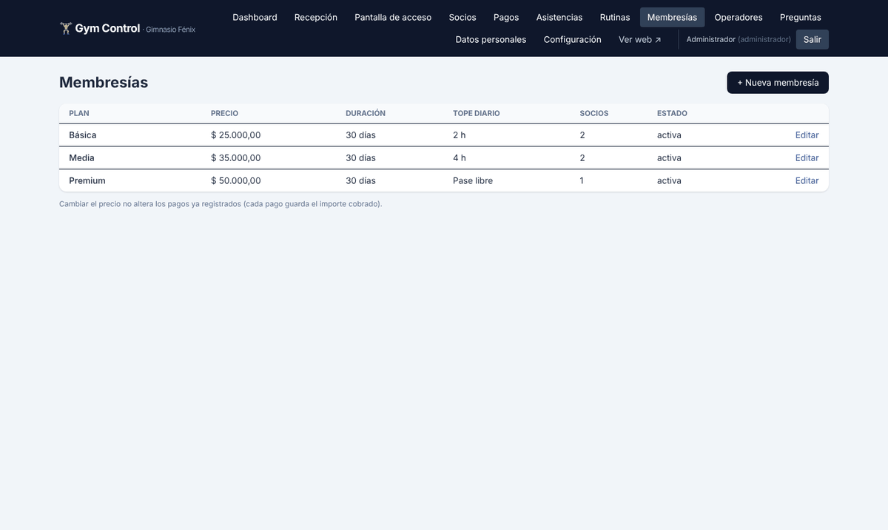

### 5.4 Operadores

En **Operadores** se dan de alta las cuentas del personal con nombre, correo, contraseña (mínimo 8 caracteres, con
letras y números) y rol: administrador, recepcionista o profesor. Al editar un operador se puede **restablecer su
contraseña** (escribiendo una nueva) o **desactivarlo**: un operador inactivo ya no puede iniciar sesión. En los dos
casos se cierran las sesiones que ese operador tenía abiertas. El administrador no puede quitarse a sí mismo el rol
ni desactivarse.

**Mi contraseña.** Cualquier operador cambia su propia contraseña haciendo clic en su nombre, arriba a la derecha
(en el celular, *Mi contraseña* en el menú). Tiene que escribir la contraseña actual y dos veces la nueva.

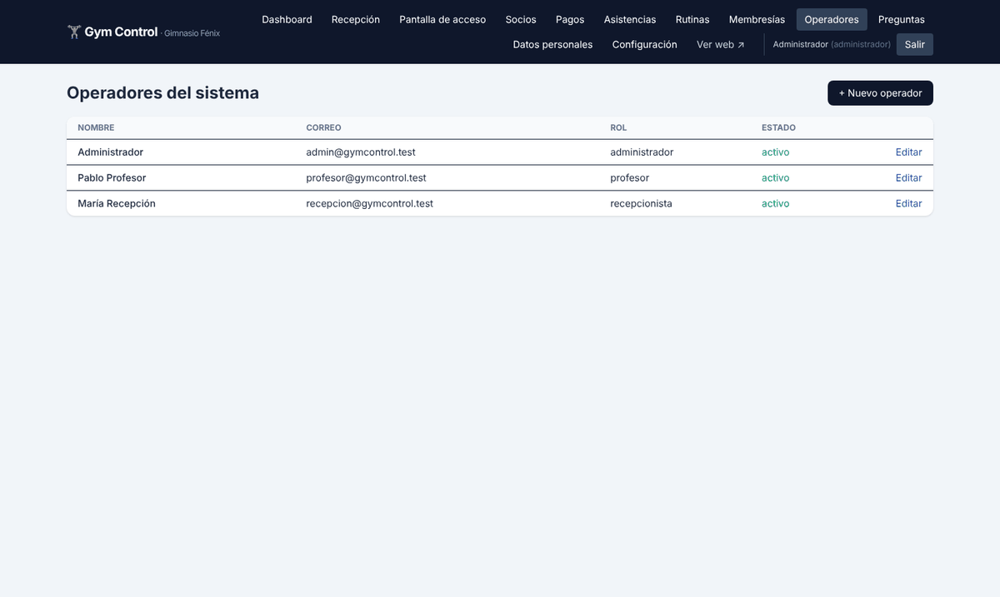

### 5.5 Preguntas frecuentes del chatbot

En **Preguntas** se cargan las preguntas que responde el chatbot: la pregunta, la respuesta, las **palabras
clave** con las que se la reconoce y el orden. Una pregunta desactivada deja de usarse. Los planes, los precios
y la cantidad de gente en el gimnasio no hace falta cargarlos: el chatbot los responde con los datos actuales.

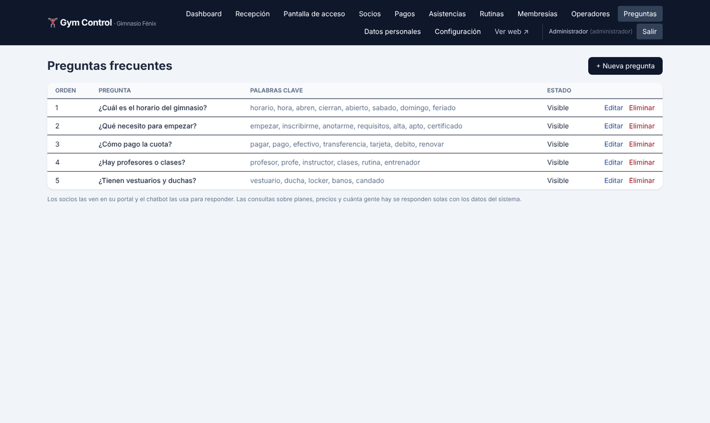

### 5.6 Configuración

En **Configuración** se define la **capacidad máxima del local**, que se usa para calcular el aforo (libre por
debajo del 50 %, moderado por debajo del 80 % y lleno desde el 80 %), y los textos de la web pública: dirección,
teléfono, correo, Instagram y horarios.

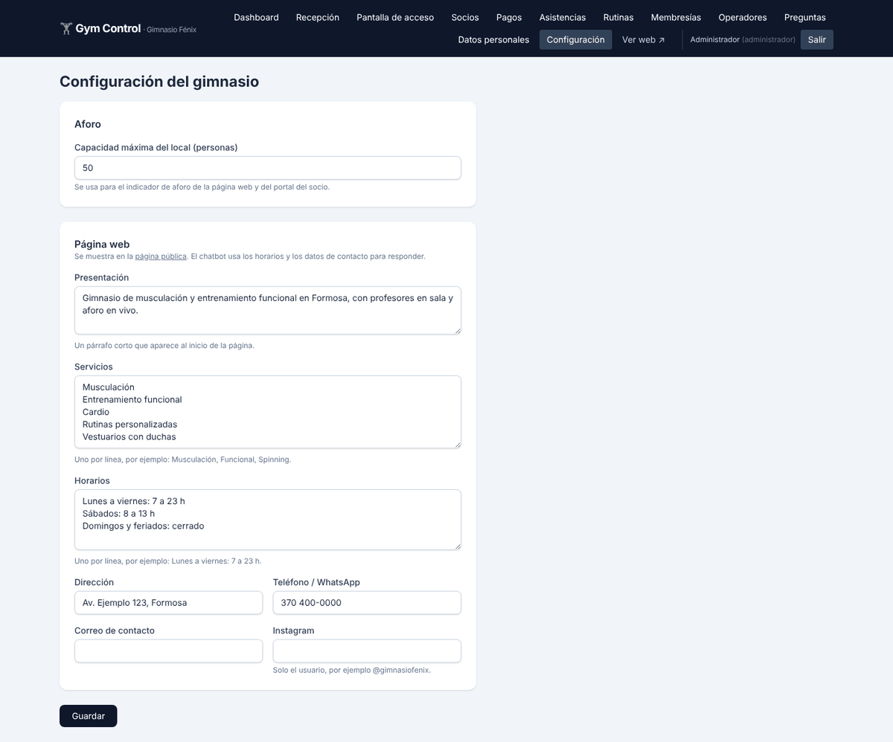

### 5.7 Pedidos sobre datos personales

En **Datos personales** aparecen los pedidos de **rectificación** o **supresión** que los socios hacen desde su
portal. Cada pedido muestra el plazo de 5 días hábiles para responder (art. 16 de la Ley 25.326); los vencidos se
marcan en rojo. Para responder, escribir la respuesta y presionar **Responder y cerrar**. Responder no borra
datos: si corresponde suprimirlos, se hace con la baja lógica del socio.

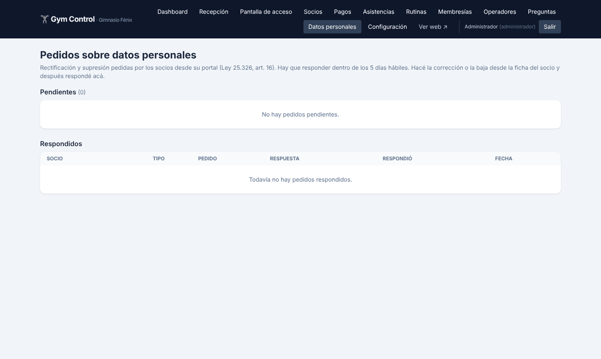

## 6. Profesor

### 6.1 Pedidos de rutina

En **Rutinas** el profesor ve los pedidos de los socios, con su objetivo, nivel, días por semana y comentarios.
Para atender uno:

1. Presionar **Armar rutina** en el pedido.
2. Opcionalmente, elegir una rutina de la biblioteca para empezar con ejercicios ya cargados; primero se sugieren
   las que coinciden con el pedido.
3. Completar o ajustar el nombre, el objetivo y los ejercicios de cada día (series, repeticiones, descanso y
   notas). Con **+ Agregar ejercicio** se suman filas.
4. Presionar **Guardar y enviar al socio**. La rutina aparece en el portal del socio y reemplaza a la anterior.

Una rutina ya enviada se puede corregir con **Editar**.

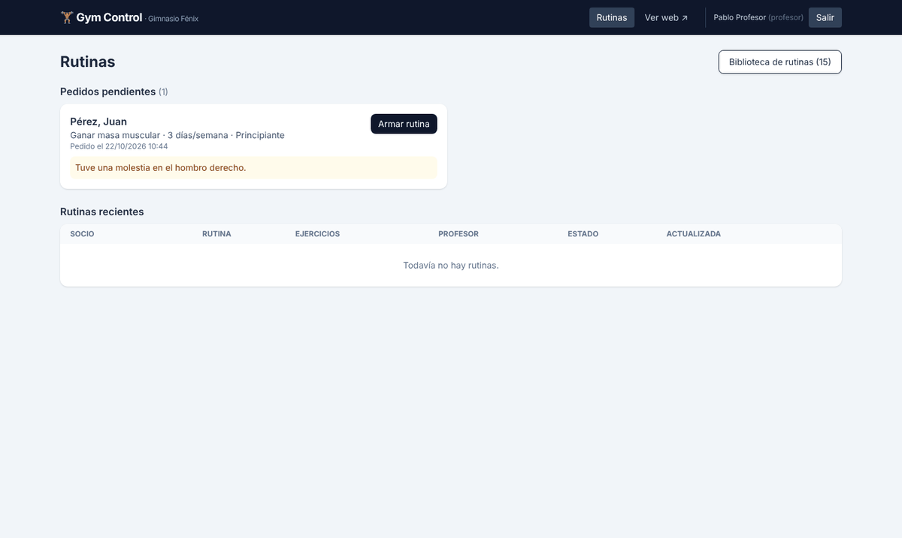

### 6.2 Biblioteca de rutinas

La **Biblioteca de rutinas** tiene 15 rutinas semanales completas (R01 a R15), organizadas por objetivo, nivel y
días por semana. Sirve para consultar y como punto de partida al armar una rutina.

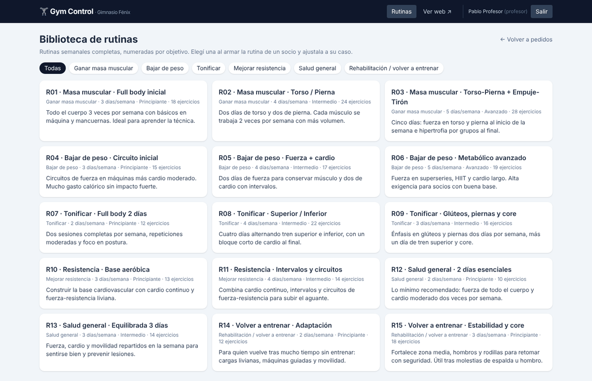

## 7. Socio: portal del socio

El portal funciona en el celular y se abre desde la web con el botón **Soy socio** o en `/socio/login`.

### 7.1 Ingreso

Escribir el **DNI** y el **PIN** de 6 dígitos que figura en la credencial, y presionar **Ingresar**. Después de 5
intentos fallidos el DNI queda bloqueado 15 minutos, para evitar que otra persona adivine el PIN.

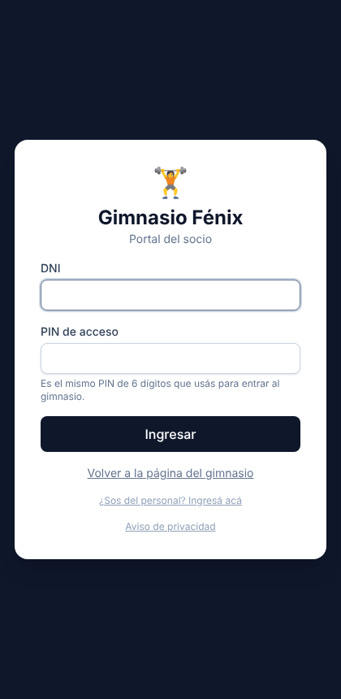

### 7.2 Mi cuenta

Muestra cuánta gente hay en el gimnasio en este momento, la membresía, el estado de la cuota y del apto físico, y
las últimas asistencias. Desde el menú se accede a:

- **Asistencias:** el historial completo, con filtro por fechas.
- **Pagos:** los pagos realizados y su comprobante en PDF.
- **Apto médico:** los certificados presentados, su vigencia y la descarga del archivo.

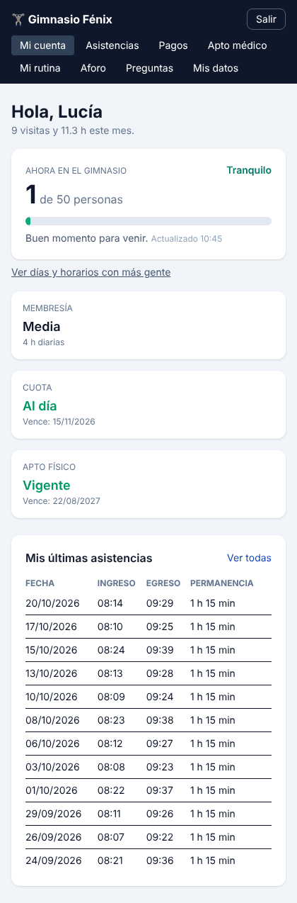

### 7.3 Aforo

Muestra cuántas personas hay ahora respecto de la capacidad del local, con un color: verde (tranquilo), amarillo
(moderado) o rojo (lleno). Se actualiza **en el momento** en que alguien entra o sale. Debajo hay un gráfico con
los días y horarios con más gente, calculado con el promedio de las últimas 4 semanas, para elegir cuándo ir.

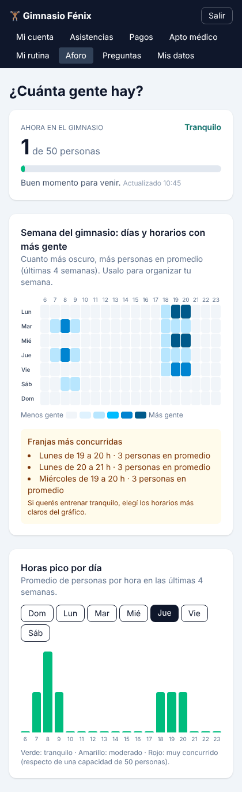

### 7.4 Preguntas (chatbot)

El socio escribe su duda y el asistente responde al instante, aunque se escriba sin tildes. Si no encuentra la
respuesta, sugiere preguntas parecidas y deriva a recepción. Debajo están todas las preguntas frecuentes.

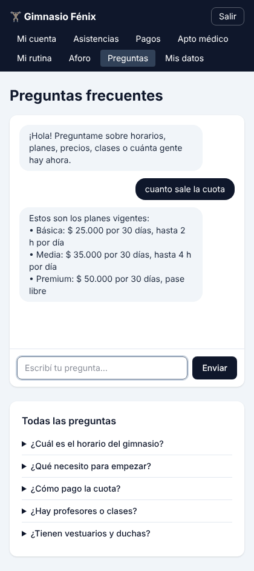

### 7.5 Mi rutina

El socio pide una rutina indicando su objetivo, su nivel, cuántos días por semana va y un comentario. Solo puede
tener un pedido pendiente a la vez. Cuando el profesor la arma, la rutina aparece en esta misma pantalla,
organizada por día.

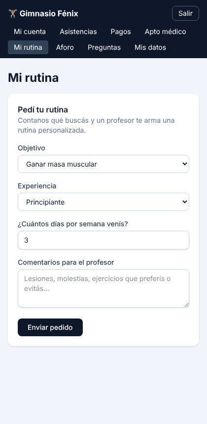

### 7.6 Mis datos

Muestra los datos personales que el gimnasio tiene del socio y la fecha en que aceptó el aviso de privacidad.
Desde aquí puede pedir que se **corrijan** (rectificación) o se **eliminen** (supresión), explicando el pedido en
al menos 10 caracteres. El gimnasio responde dentro de los 5 días hábiles y la respuesta se ve en esta pantalla.

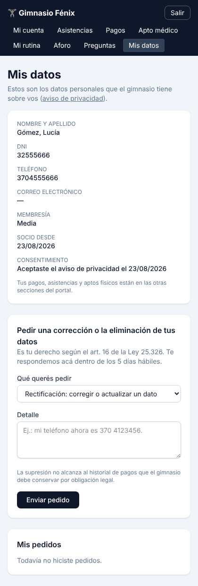

## 8. Preguntas frecuentes del personal

| Situación | Solución |
|---|---|
| Un socio olvidó su PIN | Buscarlo por DNI en *Socios*; el PIN está en su ficha y se puede reimprimir la credencial |
| Un socio se fue sin marcar la salida | No le impide volver a ingresar otro día; esa visita queda sin egreso en el historial |
| El lector de QR no funciona | Ingresar el PIN a mano: siempre está disponible como alternativa |
| Un operador olvidó su contraseña | El administrador escribe una nueva en *Operadores*, editando la cuenta, y se la pasa en persona |
| El administrador olvidó su contraseña | Otro administrador la restablece; si no hay otro, el responsable técnico ejecuta `php artisan gym:clave-operador correo` en el servidor |
| Cambió el precio de un plan | Editarlo en *Membresías*; los pagos anteriores conservan el importe cobrado |
| El aforo no cambia en el portal | Recargar la página; si la conexión en vivo falla, el aforo se actualiza solo cada 30 segundos |

## 9. Glosario

- **Apto físico:** certificado médico que habilita a entrenar; tiene fecha de vencimiento.
- **Aforo:** cantidad de personas dentro del gimnasio en un momento dado.
- **Baja lógica:** el registro deja de estar activo, pero no se borra, para conservar su historial.
- **Credencial:** tarjeta del socio con su PIN y su código QR.
- **Cuota al día:** la fecha de vencimiento de la cuota es hoy o posterior.
- **PIN:** número de 6 dígitos, único para cada socio, que identifica al socio en la pantalla de acceso y en el
  portal.
- **Tope de horas diarias:** horas que el plan permite entrenar por día; Premium no tiene tope.
