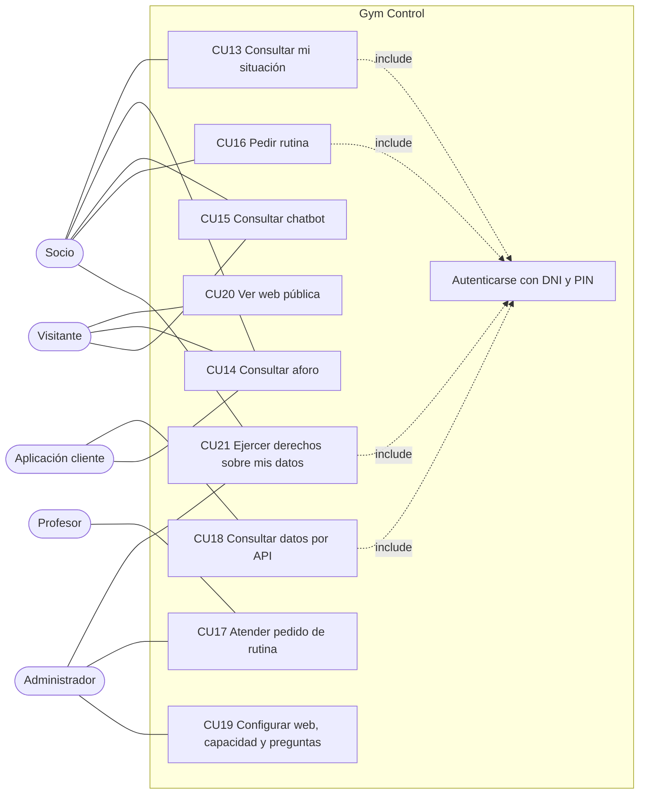
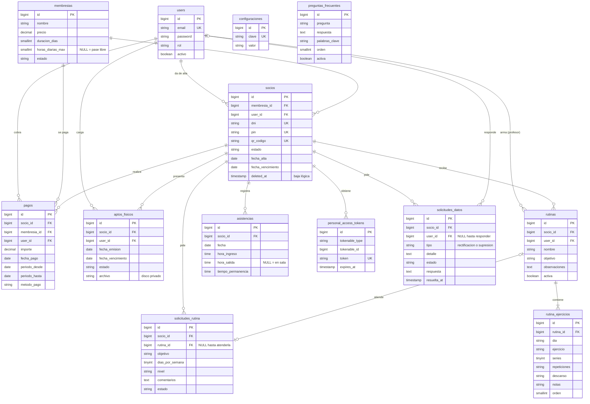

# Actualización de requerimientos del Plan de Trabajo

**Proyecto:** Gym Control, sistema de gestión y control de asistencia del Gimnasio Fénix (Formosa).
**Equipo:** Grupo 13, Cardozo Diego Fabián, Heretichi Adriana y López Gabriela Elvira.
**Sprint:** 2 del Plan de Trabajo (26/10/2026 al 05/11/2026), historias HU13 a HU17 y HU28.

## 1. Propósito

El Plan de Trabajo aprobado por el profesor Eduardo Roig (versión final, presentada el 14/10/2026) especifica nueve requerimientos funcionales (RF01–RF09), seis no funcionales
(RNF01–RNF06) y doce historias de usuario (HU1–HU12) para dos actores: administrador y recepcionista. Durante el
desarrollo se incorporaron funcionalidades que el Plan no describe: la página web pública, el portal del socio,
la consulta de aforo, el chatbot de preguntas frecuentes, las rutinas armadas por un profesor y una API REST.

Este documento completa la especificación para que sea **trazable** en el sentido de la norma IEEE 830: cada
requerimiento nuevo se vincula con su historia de usuario, con el código que lo implementa y con la prueba
automatizada que lo verifica. Las funcionalidades ya están implementadas y probadas; lo que se agrega aquí es su
especificación formal.

## 1 bis. Relación con el Plan aprobado

El Plan de Trabajo y su anexo *Maquetación y base de datos de Gym Control* son la línea base del alcance. Este
documento no los reemplaza: los amplía. La Tabla A resume qué se mantiene igual y qué cambió.

**Tabla A.** Comparación entre el Plan aprobado y el sistema implementado.

| Tema | Plan aprobado | Sistema implementado | Situación |
|---|---|---|---|
| Modelo de datos núcleo | Seis tablas (Tablas 3 a 8 del diccionario de datos) | Las mismas seis tablas, con los mismos tipos, longitudes, nulos y restricciones únicas | Coincide |
| Reglas de negocio | Cuota al día, ingreso con tres condiciones, egreso siempre permitido, tope de horas | `AccesoService`, `PagoService` y `app/Services/ReglasIngreso` | Coincide |
| Roles | Administrador y recepcionista | Se suma el profesor (RF13) | Ampliación |
| Socio | "No opera el sistema: solo se identifica con su PIN o QR" | Además usa el portal del socio con DNI y PIN (RF10) | Ampliación |
| Autenticación | "No se incorporan tokens de acceso ni API externa" | API REST con tokens de Sanctum (RF14) | Ampliación |
| Tablas | Seis más las de soporte de Laravel | Se suman `configuraciones`, `preguntas_frecuentes`, rutinas, `solicitudes_datos`, `personal_access_tokens` y `socios.consentimiento_datos_at` (sección 7) | Ampliación |
| Accesos denegados | Tabla de auditoría como mejora futura | El evento `AccesoDenegado` se registra en el log con el motivo (HU21); no hay tabla | Parcial |
| Panel de recepción | Figura 3: buscador rápido, socios en sala y accesos recientes | El recepcionista entra al listado de socios (`User::rutaInicio()`) | Pendiente |

Las ampliaciones siguen el procedimiento de la Tabla 7 del Plan (riesgo "Cambios de alcance"): se validan con la
Product Owner al inicio del sprint. Ninguna modifica las seis tablas aprobadas, de modo que el modelo relacional del
Plan sigue vigente y las tablas nuevas se agregan con migraciones propias.

## 2. Actores

| Actor | Descripción | Cómo se autentica |
|---|---|---|
| Administrador | Dueño o encargado del gimnasio. Configura el sistema y ve los datos económicos | Correo y contraseña (sesión de operador) |
| Recepcionista | Atiende el mostrador: altas, cobros, aptos y control de acceso | Correo y contraseña (sesión de operador) |
| Profesor | Arma las rutinas de entrenamiento que piden los socios | Correo y contraseña (sesión de operador) |
| Socio | Cliente del gimnasio. Consulta su situación, el aforo y el chatbot, y pide rutinas | DNI y PIN de 6 dígitos (sesión propia del portal) |
| Visitante | Cualquier persona que entra a la web pública sin iniciar sesión | No se autentica |
| Aplicación cliente | Programa externo (por ejemplo, una app móvil) que consume la API REST | Token Bearer de Laravel Sanctum obtenido con DNI y PIN |

Las sesiones de operador y de socio son independientes: el middleware `socio` (`SocioAutenticado`) protege el
portal y el middleware `rol:` protege el panel, de modo que una sesión no da acceso a la otra.

## 3. Fichas de requerimientos funcionales nuevos

La prioridad usa la escala de la cátedra: **Esencial** (sin esto el sistema no cumple su objetivo), **Útil**
(mejora el valor percibido) y **Deseable** (puede quedar para una versión posterior).

### RF10 — Portal del socio

| Campo | Detalle |
|---|---|
| Descripción | El socio ingresa con su DNI y su PIN y consulta su membresía, el vencimiento de su cuota, su historial de asistencias, sus pagos y sus constancias médicas |
| Entradas | DNI, PIN de 6 dígitos; filtros opcionales de fecha desde y hasta en el historial |
| Proceso | Valida que el DNI exista, que el PIN coincida y que el socio esté activo y no dado de baja. Limita a 5 los intentos fallidos por DNI, con bloqueo de 15 minutos. Abre una sesión propia (`socio_id`) separada de la de operadores. Cada consulta filtra por el socio de la sesión |
| Salidas | Panel con plan, estado de la cuota y vencimiento; listado de asistencias con total de horas; listado de pagos con comprobante PDF; listado de aptos con vigencia y descarga del archivo propio |
| Prioridad | Esencial |
| Reglas | Un socio nunca ve datos de otro socio. Un socio dado de baja pierde la sesión abierta |
| Historia | HU13 |

### RF11 — Consulta de aforo

| Campo | Detalle |
|---|---|
| Descripción | El socio, el visitante y la aplicación cliente consultan cuántas personas hay en el gimnasio y en qué horarios suele haber más gente |
| Entradas | Capacidad máxima configurada por el administrador; asistencias registradas por la pantalla de acceso |
| Proceso | Presentes = asistencias del día sin hora de salida. Porcentaje = presentes / capacidad. Nivel: libre si es menor a 50 %, moderado si es menor a 80 %, lleno desde 80 %. Horas pico = promedio de personas presentes por hora y día de la semana en las últimas 4 semanas; una asistencia sin egreso se cuenta como 60 minutos (`AforoService::PERMANENCIA_ESTIMADA`) |
| Salidas | Cantidad de presentes, capacidad, porcentaje y nivel con color (verde, amarillo, rojo), actualizado cada 30 segundos; mapa semanal de horas pico y las tres franjas más concurridas |
| Prioridad | Esencial (es la necesidad que originó la ampliación del sistema) |
| Reglas | La consulta de aforo no expone datos personales, solo cantidades. Solo el administrador cambia la capacidad |
| Historia | HU14 |

### RF12 — Chatbot de preguntas frecuentes

| Campo | Detalle |
|---|---|
| Descripción | El socio y el visitante escriben una pregunta en lenguaje natural y reciben la respuesta de la pregunta frecuente que mejor coincide |
| Entradas | Mensaje del usuario; preguntas frecuentes activas con sus palabras clave, cargadas por el administrador |
| Proceso | Normaliza el mensaje (minúsculas, sin tildes ni signos), descarta palabras vacías y compara raíces simples para que plurales y variantes coincidan. Calcula un puntaje por pregunta y responde la mejor si alcanza el mínimo (`ChatbotService::PUNTAJE_MINIMO`). Planes y precios, aforo, horarios y contacto se responden con los datos vigentes del sistema |
| Salidas | Respuesta y preguntas relacionadas sugeridas; si nada coincide, sugerencias y derivación a recepción |
| Prioridad | Útil |
| Reglas | No usa inteligencia artificial ni servicios pagos. Las preguntas desactivadas no se usan |
| Historia | HU15 |

### RF13 — Rutinas de entrenamiento

| Campo | Detalle |
|---|---|
| Descripción | El socio pide una rutina; un profesor la arma, si quiere a partir de la biblioteca R01–R15, y el socio la ve en su portal |
| Entradas | Pedido del socio: objetivo, días por semana (1 a 7), nivel y comentarios. Rutina del profesor: nombre, objetivo, observaciones y ejercicios por día con series, repeticiones, descanso y notas |
| Proceso | El socio solo puede tener un pedido pendiente. El profesor ve los pedidos, se le sugieren primero las plantillas que coinciden con el pedido y guarda la rutina en una transacción. La rutina nueva reemplaza a la anterior (una sola activa por socio) y el pedido pasa a atendido |
| Salidas | Lista de pedidos pendientes; rutina activa visible en el portal del socio |
| Prioridad | Útil |
| Reglas | La rutina exige al menos un ejercicio. Solo el administrador y el profesor acceden a *Rutinas* |
| Historia | HU16 |

### RF14 — API REST

| Campo | Detalle |
|---|---|
| Descripción | Una aplicación cliente consulta el aforo sin autenticarse y, con un token del socio, su perfil y sus asistencias |
| Entradas | Peticiones HTTP con JSON; DNI y PIN para obtener el token; encabezado `Authorization: Bearer <token>` |
| Proceso | El login reutiliza `AutenticacionSocioService` (mismas reglas y límite de intentos que el portal) y emite un token de Sanctum que vence a los 30 días. Las rutas protegidas usan `auth:sanctum` y `socio.token`. El logout revoca el token usado |
| Salidas | JSON con el estado del aforo; token, tipo y vencimiento; perfil del socio sin PIN; asistencias paginadas de a 20 con filtro por fecha |
| Prioridad | Deseable |
| Reglas | El aforo público tiene un límite de 60 peticiones por minuto y el login de 10. Un socio dado de baja deja de poder usar su token |
| Historia | HU17 |

### RF15 — Página web pública

| Campo | Detalle |
|---|---|
| Descripción | Cualquier visitante conoce el gimnasio, sus planes y precios, horarios y contacto, ve el aforo en vivo y usa el chatbot |
| Entradas | Textos de presentación, horarios y contacto cargados por el administrador en *Configuración*; membresías activas |
| Proceso | Arma la página con los datos vigentes. Si faltan textos, la página igual se muestra |
| Salidas | Página en `/` con enlaces al portal del socio y al login del personal |
| Prioridad | Útil |
| Historia | HU28 |

### RF16 — Derechos sobre los datos personales

| Campo | Detalle |
|---|---|
| Descripción | El socio conoce el aviso de privacidad, da su consentimiento, consulta sus datos y pide que se corrijan o se eliminen; el administrador responde |
| Entradas | Aceptación del aviso en el alta; pedido del socio: tipo (rectificación o supresión) y detalle; respuesta del administrador |
| Proceso | Se guarda la fecha del consentimiento y sin él no se carga el apto físico. El socio tiene un solo pedido pendiente de cada tipo. El sistema calcula el plazo de respuesta de 5 días hábiles (art. 16) y marca en rojo los vencidos. Al responder se registra quién y cuándo, y la respuesta no se puede reescribir |
| Salidas | Aviso en `/privacidad`; pantalla *Mis datos* del portal con los datos personales y el historial de pedidos; bandeja *Datos personales* del administrador |
| Prioridad | Esencial (lo exige la Ley 25.326) |
| Reglas | Solo el administrador ve y responde los pedidos. Responder no borra datos: la corrección o la baja se hacen desde la ficha del socio. El plazo cuenta de lunes a viernes y no descuenta feriados |
| Historia | HU26, HU27 |

## 4. Historias de usuario

Estado del código: **Done** en todas (implementadas y con pruebas en verde). Estado de la documentación: **Done**
con este documento, pendiente de la revisión del equipo.

| HU | RF | Historia | Criterios de aceptación |
|---|---|---|---|
| HU13 | RF10 | Como socio quiero entrar a un portal con mi DNI y mi PIN para ver mi membresía, pagos, asistencias y aptos sin ir a recepción | 1) Con DNI y PIN correctos entro y veo mi plan y vencimiento. 2) Con PIN incorrecto se rechaza y al quinto intento se bloquea el DNI. 3) Un socio inactivo o dado de baja no entra. 4) Solo veo mis asistencias, pagos y archivos. 5) Mi sesión no abre el panel de operadores |
| HU14 | RF11 | Como socio quiero ver cuánta gente hay y las horas pico para decidir cuándo ir al gimnasio | 1) Se cuentan solo los presentes de hoy sin egreso. 2) El nivel es libre, moderado o lleno según el porcentaje. 3) El mapa semanal promedia las últimas 4 semanas. 4) Sin historial se avisa que faltan datos. 5) Solo el administrador cambia la capacidad |
| HU15 | RF12 | Como socio quiero preguntarle a un chatbot las dudas frecuentes para no tener que llamar al gimnasio | 1) Encuentra la respuesta aunque escriba sin tildes o en plural. 2) No usa preguntas desactivadas. 3) Responde precios y aforo con datos actuales. 4) Si no entiende, sugiere preguntas y deriva a recepción. 5) Solo el administrador gestiona las preguntas |
| HU16 | RF13 | Como profesor quiero ver los pedidos de rutina y armarlas desde una biblioteca para atender a los socios más rápido | 1) El socio tiene un solo pedido pendiente a la vez. 2) El profesor ve los pedidos y arma la rutina. 3) La rutina nueva reemplaza a la anterior. 4) Exige al menos un ejercicio y se puede editar. 5) Las 15 plantillas de la biblioteca pasan la validación |
| HU17 | RF14 | Como aplicación cliente quiero consultar el aforo y los datos del socio por API REST para integrarme con el sistema | 1) `GET /api/aforo` es público y no expone datos personales. 2) El login devuelve un token Bearer y responde 401 con PIN incorrecto. 3) Sin token se responde 401 en JSON. 4) El socio solo ve sus asistencias. 5) El logout revoca el token |
| HU25 | RF11 | Como socio quiero ver el aforo actualizarse en el momento en que alguien entra o sale para decidir cuándo ir sin recargar la página | 1) Cada ingreso o egreso transmite el aforo por el canal público `aforo`; un rechazo no. 2) El evento solo lleva cantidades, nunca datos del socio. 3) El componente se vuelve a dibujar al recibirlo. 4) Si el servidor de WebSockets falla, el acceso se registra igual y sigue el sondeo cada 30 s |
| HU26 | RF16 | Como socio quiero conocer cómo se usan mis datos y dar mi consentimiento para que el gimnasio trate mi apto físico de forma legal | 1) El aviso está en `/privacidad` y se enlaza desde la web y el portal. 2) El alta exige aceptar el aviso y guarda la fecha. 3) Sin consentimiento no se carga el apto |
| HU27 | RF16 | Como socio quiero ver mis datos personales y pedir que se corrijan o se eliminen para ejercer mis derechos sin ir a recepción | 1) En *Mis datos* veo mis datos y la fecha de mi consentimiento. 2) Pido rectificación o supresión con un detalle de al menos 10 caracteres. 3) No se duplica un pedido pendiente del mismo tipo. 4) Veo el plazo de 5 días hábiles y la respuesta. 5) Solo el administrador responde, una sola vez |
| HU28 | RF15 | Como visitante quiero ver la web del gimnasio con planes, horarios y aforo para decidir si me hago socio | 1) Muestra los planes activos con su precio. 2) Funciona aunque falten textos. 3) El chatbot responde horarios y contacto cargados. 4) Solo el administrador edita los textos |

## 5. Casos de uso

Un caso de uso es una funcionalidad completa que le da valor a un actor, no un paso de la interfaz. Los casos
CU01–CU12 del Plan cubren al administrador y al recepcionista; se agregan los siguientes.

| Caso de uso | Actor principal | Flujo principal | Flujo alternativo |
|---|---|---|---|
| CU13 Consultar mi situación | Socio | Ingresa DNI y PIN, ve su panel y navega asistencias, pagos y aptos | Datos incorrectos: mensaje de error; cinco fallos: bloqueo de 15 minutos |
| CU14 Consultar aforo | Socio, visitante, aplicación cliente | Ve presentes, nivel y horas pico | Sin historial: aviso de que faltan datos |
| CU15 Consultar chatbot | Socio, visitante | Escribe una pregunta y recibe la respuesta | Sin coincidencia: sugerencias y derivación a recepción |
| CU16 Pedir rutina | Socio | Completa objetivo, nivel y días, y envía el pedido | Ya tiene un pedido pendiente: se le avisa y no se duplica |
| CU17 Atender pedido de rutina | Profesor (o administrador) | Elige un pedido, parte de una plantilla, ajusta y guarda | Sin ejercicios: la validación lo rechaza |
| CU18 Consultar datos por API | Aplicación cliente | Obtiene un token con DNI y PIN y consulta perfil y asistencias | Token inválido o socio dado de baja: 401 |
| CU19 Configurar web, capacidad y preguntas | Administrador | Edita textos, capacidad máxima y preguntas frecuentes | — |
| CU20 Ver web pública | Visitante | Entra a `/` y ve planes, horarios, contacto y aforo | — |
| CU21 Ejercer derechos sobre mis datos | Socio (el administrador responde) | Ve sus datos en *Mis datos*, pide rectificación o supresión y luego lee la respuesta | Ya tiene un pedido pendiente del mismo tipo: se le avisa y no se duplica |

`include` indica que el caso siempre ejecuta otro (todos los del socio pasan por la autenticación). Se usa con
moderación, como pide la cátedra.

## 6. Matriz de permisos actualizada

| Funcionalidad | Admin | Recepción | Profesor | Socio (portal o API) | Visitante |
|---|---|---|---|---|---|
| Socios (alta, edición, PIN y QR), aptos, pagos, pantalla de acceso, historiales y PDF | Sí | Sí | — | — | — |
| Baja lógica de socios, membresías, operadores, preguntas, configuración, dashboard económico | Sí | — | — | — | — |
| Responder pedidos de rectificación y supresión de datos | Sí | — | — | — | — |
| Rutinas: ver pedidos, armar y editar, biblioteca R01–R15 | Sí | — | Sí | — | — |
| Ver su membresía, asistencias, pagos y aptos; pedir rutina | — | — | — | Sí | — |
| Ver sus datos personales y pedir rectificación o supresión | — | — | — | Sí (portal) | — |
| Aforo y chatbot | Sí | Sí | — | Sí | Sí |
| Web pública | Sí | Sí | Sí | Sí | Sí |

Implementación: grupos de rutas con `rol:administrador,recepcionista`, `rol:administrador,profesor` y
`rol:administrador` en `routes/web.php`; middleware `socio` para el portal; `auth:sanctum` y `socio.token` en
`routes/api.php`.

## 7. Modelo entidad-relación actualizado

Se agregan a las seis tablas núcleo del Plan las tablas `configuraciones`, `preguntas_frecuentes`,
`solicitudes_rutina`, `rutinas`, `rutina_ejercicios`, `solicitudes_datos` y `personal_access_tokens` (de
Sanctum).

**Justificación de las tablas nuevas frente a la tercera forma normal:**

- `rutina_ejercicios` separa los ejercicios de la rutina porque una rutina tiene muchos: guardarlos en una
  columna de `rutinas` violaría la 1FN (valores repetidos en un mismo campo).
- `solicitudes_datos.user_id` es opcional por la misma razón: el pedido existe antes de que un administrador lo
  responda.
- `solicitudes_rutina.rutina_id` es opcional (`nullOnDelete`): el pedido existe antes de que haya rutina.
- `configuraciones` usa el formato clave-valor para los pocos datos sueltos del gimnasio (capacidad, horarios,
  contacto). Es una decisión de diseño consciente: evita una tabla de una sola fila con muchas columnas
  opcionales, a cambio de que el valor se guarde como texto.
- `preguntas_frecuentes.palabras_clave` guarda una lista separada por comas. Es una excepción a la 1FN que se
  acepta porque el campo solo se usa como texto de búsqueda del chatbot, nunca se filtra ni se relaciona por
  cada palabra. Si en el futuro se necesitara, se normaliza con una tabla `palabras_clave`.
- `personal_access_tokens` es la tabla estándar de Sanctum; su relación con `socios` es polimórfica
  (`tokenable_type` y `tokenable_id`).

## 8. Matriz de trazabilidad

Trazable significa poder ir del requerimiento a la historia, al código que lo implementa y a la prueba que lo
verifica, y también en sentido inverso.

| RF | HU | Código principal | Prueba que lo verifica |
|---|---|---|---|
| RF01 Gestión de usuarios y sesión | HU1, HU12 | `AuthController.php`, `app/Http/Middleware/RolMiddleware.php`, `routes/web.php` | `RolesTest` (6 pruebas) |
| RF02 Gestión de socios | HU2, HU5 | `SocioController.php`, `app/Http/Requests/SocioRequest.php`, `app/Policies/SocioPolicy.php`, `app/Livewire/SociosIndex.php`, `Socio::booted()` (PIN y QR) | `AccesoTest::test_el_socio_recibe_pin_de_6_digitos_y_qr_unicos`, `GestionTest` |
| RF03 Gestión de membresías | HU3 | `MembresiaController.php`, `app/Http/Requests/MembresiaRequest.php` | `GestionTest` |
| RF04 Gestión de pagos | HU4 | `PagoController.php`, `app/Services/PagoService.php` | `PagoTest` (3) |
| RF05 Gestión de aptos físicos | HU8 | `AptoFisicoController.php`, `app/Http/Requests/AptoFisicoRequest.php`, `app/Policies/AptoFisicoPolicy.php`, `gym:actualizar-vencimientos` | `AccesoTest::test_sin_apto_fisico_deniega_ingreso`, `GestionTest` |
| RF06 Control de acceso | HU6, HU7 | `app/Services/AccesoService.php`, `app/Livewire/PantallaAcceso.php` | `AccesoTest` (9) |
| RF07 Historial de asistencias | HU11 | `AsistenciaController.php`, `resources/views/pdf/` | Sin prueba automatizada (pendiente) |
| RF08 Dashboard e informes | HU9, HU11 | `DashboardController.php`, `PagoController::pdf()`, `SocioController::fichaPdf()` | `RolesTest::test_administrador_accede_a_todo` (solo acceso; el cálculo está pendiente) |
| RF09 Gestión de operadores | HU10 | `OperadorController.php` | `RutinaTest::test_el_admin_puede_crear_un_profesor` |
| RF10 Portal del socio | HU13 | `app/Http/Controllers/Portal/AuthSocioController.php`, `PortalController.php`, `HistorialController.php`, `app/Services/AutenticacionSocioService.php`, `app/Http/Middleware/SocioAutenticado.php` | `PortalSocioTest` (9), `PortalHistorialTest` (5) |
| RF11 Consulta de aforo | HU14, HU25 | `app/Services/AforoService.php`, `app/Livewire/AforoEnVivo.php`, `app/Http/Controllers/Portal/AforoController.php`, `app/Events/AforoActualizado.php`, `app/Listeners/TransmitirAforo.php` | `AforoTest` (9), `AforoTiempoRealTest` (5) |
| RF12 Chatbot | HU15 | `app/Services/ChatbotService.php`, `app/Livewire/ChatbotFaq.php`, `PreguntaFrecuenteController.php` | `ChatbotTest` (7) |
| RF13 Rutinas | HU16 | `RutinaController.php`, `app/Http/Controllers/Portal/RutinaSocioController.php`, `app/Support/PlantillasRutina.php`, `app/Http/Requests/RutinaRequest.php`, `app/Policies/RutinaPolicy.php` | `RutinaTest` (11) |
| RF14 API REST | HU17 | `routes/api.php`, `app/Http/Controllers/Api/`, `app/Http/Requests/LoginSocioRequest.php`, `app/Http/Resources/`, `app/Http/Middleware/SocioConToken.php` | `ApiTest` (11) |
| RF15 Web pública | HU28 | `WebController.php`, `ConfiguracionController.php`, `resources/views/web/` | `WebTest` (7) |
| RF16 Derechos sobre los datos personales | HU26, HU27 | `WebController::privacidad()`, `app/Http/Controllers/Portal/MisDatosController.php`, `SolicitudDatosController.php`, `app/Services/SolicitudDatosService.php`, `app/Models/SolicitudDatos.php` | `PrivacidadTest` (4), `SolicitudDatosTest` (6) |

Los controladores están en `app/Http/Controllers/` y las pruebas en `tests/Feature/`.

**Brechas de verificación que muestra la matriz:** RF07 y el cálculo de indicadores de RF08 no tienen pruebas
automatizadas, y RF09 solo se prueba a través del alta de un profesor. Se agregan como tareas de HU20 (Sprint 3).

## 9. Requerimientos no funcionales según ISO/IEC 25010

La norma ISO/IEC 25010 agrupa la calidad del producto en características. Cada RNF del Plan se ubica en una de
ellas y se indica cómo se cumple y qué falta.

| RNF del Plan | Característica ISO/IEC 25010 | Cómo se cumple | Evidencia | Pendiente |
|---|---|---|---|---|
| RNF01 Seguridad | Seguridad (confidencialidad, integridad, autenticidad) | Contraseñas con bcrypt; rutas protegidas por `rol:`; Policies por registro; límite de intentos en login, pantalla de acceso y PIN del socio; aptos en disco privado; sesiones de operador y socio separadas | `RolMiddleware`, `app/Policies`, `AutenticacionSocioService`, `throttle`; `RolesTest`, `AccesoTest::test_codigo_inexistente_y_limite_de_intentos`, `GestionTest` | El aviso, el consentimiento (HU26) y los pedidos de rectificación y supresión (HU27) ya están. Falta que un profesional del derecho revise el texto del aviso |
| RNF02 Rendimiento | Eficiencia de desempeño (comportamiento temporal) | `socios.fecha_vencimiento` permite validar el acceso con una sola consulta; índices en DNI, PIN, QR y fechas; el mapa de horas pico se calcula con una sola consulta | Migraciones, `AforoService::mapaSemanal()` | Medir el tiempo de respuesta en Render para respaldar el umbral de 2 segundos |
| RNF03 Disponibilidad y persistencia | Fiabilidad (disponibilidad, recuperabilidad) y portabilidad | Contenedor Docker en local y en Render; pagos en transacción; baja lógica que conserva el historial | `Dockerfile`, `docker-compose.yml`, `render.yaml`, `PagoService` | Respaldo con `mysqldump` probado (Sprint 4). El plan gratuito de Render suspende el servicio inactivo |
| RNF04 Usabilidad | Usabilidad (operabilidad, protección contra errores) | Mensajes de acceso permitido o denegado con el motivo; buscador reactivo; colores de estado | `PantallaAcceso`, `SociosIndex` | Prueba de uso en tablet con recepción |
| RNF05 Escalabilidad y mantenibilidad | Mantenibilidad (modularidad, capacidad de prueba) | MVC con la lógica en servicios; Form Requests y Policies separan validación y permisos; 127 pruebas (18 unitarias y 109 de integración) y CI con Pint | `app/Services`, `app/Http/Requests`, `.github/workflows/tests.yml` | Los 4 patrones (HU21 a HU24) documentados en `docs/DEUDA-TECNICA.md` (Sprint 4). Las pruebas unitarias ya están en `tests/Unit` (HU20) |
| RNF06 Compatibilidad | Compatibilidad y portabilidad (adaptabilidad) | Diseño responsive con Tailwind; API REST en JSON para otros clientes | Vistas Blade, `routes/api.php` | Verificación manual en celular, tablet y escritorio |
